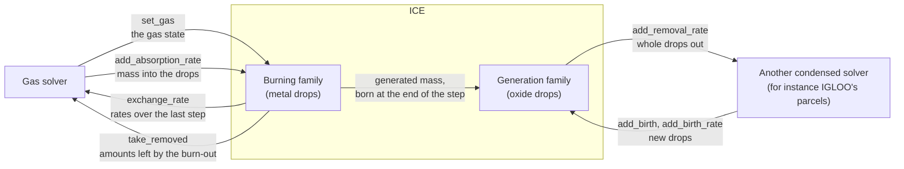
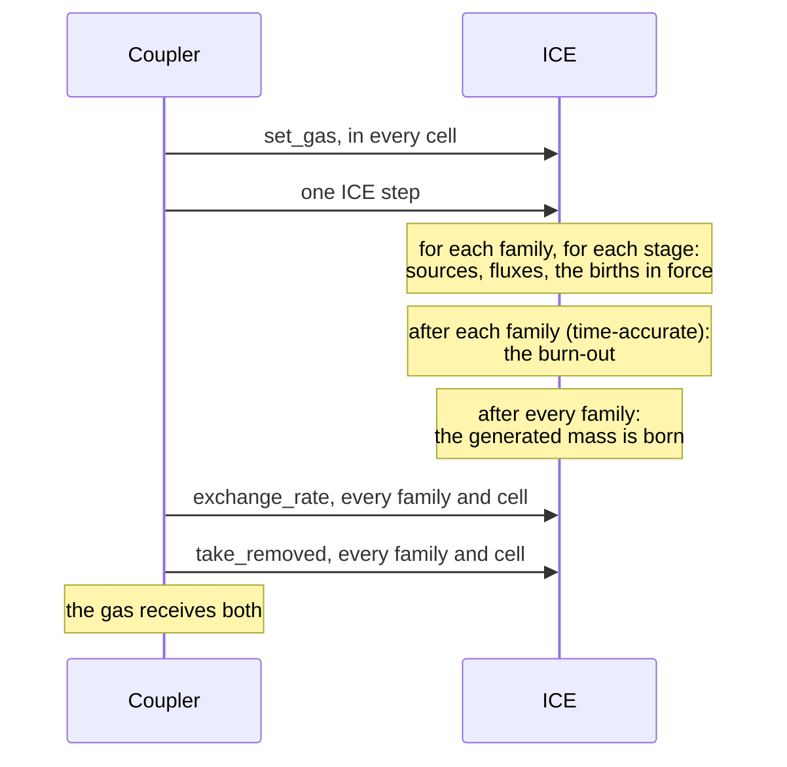

# Coupling Interface

ICE can run inside a larger code that owns the gas, such as hydra-MI2, and next to other condensed-phase solvers.
Everything that crosses ICE's boundary goes through one module, `ICE_Mod_Exchange`
(`src/lib/coupling/Mod_Exchange.f90`). A coupler needs no other part of ICE to exchange mass, momentum and energy.

## The routes



Any family can take any of the three import routes (births, absorption, removal) within the limits below; the chart
shows one of each.

| Route | Direction | Call | What travels |
|---|---|---|---|
| Gas state | gas to ICE | `set_gas` | density, velocity, temperature, gas constant, ratio of specific heats, viscosity, conductivity |
| Exchange | ICE to gas | `exchange_rate` | mass, momentum and energy per unit volume and time, over the family's last step |
| Removals | ICE to gas | `take_removed` | mass, momentum and energy per unit volume that the burn-out removed at once |
| Births | any solver to ICE | `add_birth`, `add_birth_rate` | a birth packet: mass, momentum, energy and number of drops |
| Absorption | any solver to ICE | `add_absorption_rate` | an absorption packet: mass, momentum and energy, no drops |
| Removal | ICE to any solver | `add_removal_rate` | a mass taken out as whole drops; the call returns what leaves |

Two more calls declare, at set-up, where mass is born: `set_generation` (what a burning material generates) and
`birth_family` (the family in which a mass of a given material is born).

Every call that takes a cell, `(blk, p, i, j, k)`, reads or writes only that cell of family `p`. These calls are safe
inside a parallel loop over cells. `clear_import_rates` works on every block of the rank, so call it outside parallel
regions.

## Set-up

Before ICE's own set-up, a coupler that owns the gas sets two switches:

| Switch | Module | Effect |
|---|---|---|
| `obj_sim_param%twcoupled = .true.` | `ICE_Config_Types_m` | ICE computes its sources, and over a step of several stages keeps the step's rates for `exchange_rate` |
| `ICE_gas_by_coupler = .true.` | `ICE_Global_m` | ICE reads no gas phase file; the coupler gives the gas state and the species of the burnt mass |

After ICE's set-up and before its first step, the coupler declares the generated mass, if any:

```fortran
! aluminium generates 1.889 kg of alumina per kg it burns
call set_generation(m_aluminium, 'AL2O3(L)', 1.889_R8, why)
if (len(why) > 0) error stop why

! the family in which another solver's alumina is born
p = birth_family('AL2O3(L)', why)
if (p == 0) error stop why
```

ICE refuses a declaration it cannot honour, and `why` says why in a sentence. A birth adds drops of one diameter, so
the receiving family must use the `MK` closure. Its material must neither evaporate nor burn, and it must have one
family only. The burning material's row of the models file must give `d-gen`, the diameter each generated drop is
born with. ICE running alone declares nothing, so it generates no mass.

## One coupled step



Read `exchange_rate` after an ICE step and before the next one. With several stages, the rates are weighted as the
update weighs the stages. Over the step, the gas therefore receives exactly what the family lost.

## What a family gives the gas

`exchange_rate` and `take_removed` return an `exchange_t`:

| Field | Meaning |
|---|---|
| `mass` | the mass the gas receives |
| `momentum(3)` | the momentum the gas receives: the drag, and the momentum of that mass |
| `energy` | the energy the gas receives: the heat exchanged, and the energy of that mass |
| `generated` | the mass that left the drops but is born as drops of the generation family, not as gas |
| `heat` | the heat of reaction of the mass that burns |

The drops lose `mass + generated`. A coupler whose gas has species converts that sum through the reaction of the
material (the products file ATLAS writes). The coupler also adds the formation enthalpies of what the burnt mass
becomes, less that of the generated mass, which stays condensed.

Energies are ICE's: the material's energy $e(T)$ on ICE's datum, plus the kinetic energy. A coupler whose gas measures
energy from another datum adds its own offsets.

Use `heat` only with a gas of one species: add it to that gas's energy. A gas whose species carry their formation
enthalpies already gains the heat of reaction from the change of species, so it leaves `heat` out.

`exchange_rate` returns rates per unit volume and time. `take_removed` returns amounts per unit volume: in a
time-accurate run the burn-out removes the last drops of a cell at once, at the end of a step. `take_removed` also
empties the cell's record. A coupler hands those amounts to its gas over its own steps.

## Births

A birth is described by a packet of six numbers, per unit volume:

$$
\big[\;m,\quad m\,\mathbf u,\quad m\,\big(e(T) + \tfrac12|\mathbf u|^2\big),\quad
\frac{m}{\tfrac{\pi}{6}\,\rho(T)\,d^3}\;\big]
$$

This is the mass, momentum, energy and number of drops of a mass $m$ born with velocity $\mathbf u$ at temperature
$T$, each drop of diameter $d$. Here $e$ and $\rho$ are the energy and density of the receiving family's material.
`birth_packet(p, m, u, T, d)` builds it, for an amount or for a rate alike.

There are two ways to hand a packet to ICE:

| Call | Kind | When |
|---|---|---|
| `add_birth` | an amount, born at once: added to the cell's state | both the sender and ICE are time-accurate |
| `add_birth_rate` | a rate, in force over every stage of the family's next steps, until `clear_import_rates` | either the sender or ICE is steady |

A steady run gives each cell its own pseudo-time step. A mass handed at once would then depend on those steps, and so
would the fixed point. A rate in force does not.

ICE's own generated mass follows the same rule. In each stage of a burning family, ICE adds the mass the stage burns
to the step's sum, with the stage weights of the update. At the end of the step, after every family, the sum is born
in the generation family. A time-accurate run adds it at once (`add_birth`). A steady run makes it the generation
family's births in force over its next step.

## Absorption and removal

Mass can also join the drops already in a cell, or leave them, without a birth. Both are rates per unit volume and
time, in force over every stage of the family's next steps until `clear_import_rates`, as births in force are. Neither
reaches the gas through `exchange_rate`: the coupler takes the absorbed mass from its donor and gives the removed
mass to its receiver.

| Call | What it does | Refused when |
|---|---|---|
| `add_absorption_rate(blk, p, i, j, k, pk, why)` | the drops of the cell take in the packet `pk` (`absorption_packet(p, m, u, T)`): mass, momentum and energy grow, the number of drops does not | the mass is not positive, the cell holds no drops, the family solidifies |
| `add_removal_rate(blk, p, i, j, k, m, taken, why)` | the mass `m` leaves the cell as whole drops at the cell's state; `taken` returns what leaves as a birth packet | the mass is not positive, the cell holds no drops |

An absorbed mass arrives with one velocity $\mathbf u$. The momentum gains $m\,\mathbf u$ and the energy
$m\,(e(T) + \tfrac12|\mathbf u|^2)$. A closure that carries velocity moments also gains the moment of that mass:
$m\,|\mathbf u|^2$ for `IG`, $m\,\mathbf u\otimes\mathbf u$ for `AG`.

A removal takes the same fraction $f = m/\rho_b$ of every slot of the cell's conservative state, with $\rho_b$ the
cell's bulk density when the call is made. The drops left keep their diameter, velocity and temperature. The rate is
fixed while it is in force. ICE steps such a cell no further than the step that would empty it. The coupler keeps the
rate, times the time it stays in force, below what the cell holds, and sets it again at each coupling step.

## Where it is stored

ICE's developers can find the routes in these fields of each family, `cond_phase(p)`:

| Field | Holds | Written by | Read by |
|---|---|---|---|
| `source` | the rates at which the drops gain mass, momentum and energy | `compute_source` | `exchange_rate` |
| `heat` | the heat of reaction of the mass that burns | `compute_source` | `exchange_rate` |
| `gen_rate` | the generated mass of the last step: mass, momentum, energy | `gen_accumulate` | `exchange_rate` |
| `gen_due` | the same as a birth packet, still to be born | `gen_accumulate`, `burnout_switch` | `gen_birth` |
| `removed` | the burn-out's record: the gas's mass, momentum, energy, then the generated mass | `burnout_switch` | `take_removed` |
| `imports` | the births, absorptions and removals a coupler set, in the family's conservative slots | `add_birth_rate`, `add_absorption_rate`, `add_removal_rate` | `add_births` |
| `births_gen` | steady runs: the birth rates of ICE's own generated mass | `gen_birth` | `add_births` |

The physics behind these routes is in [Generated mass](../theory/combustion.md#generated-mass).
