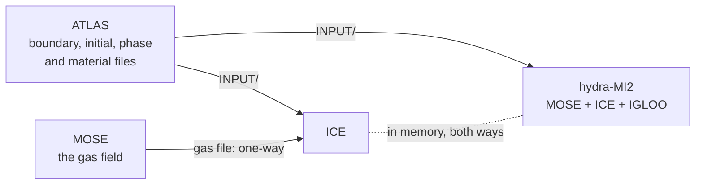

# Getting Started

ICE (*Integration of a Condensed phase via an Eulerian method*) is an open-source Eulerian solver of a dispersed
condensed phase — droplets or solid particles — written in modern Fortran, on multi-block structured grids. It
carries the cloud as a continuum: each cell holds the bulk and number densities of the drops, their velocity,
temperature and, with a Gaussian closure, their velocity spread. The gas field is read from a file, or passed in
memory by a coupler. Drag and heat transfer act in every coupled run; radiation, evaporation, combustion and
solidification are switched on per material.

!!! info "ICE within Hydra"
    ICE is the Eulerian solver of the dispersed phase in the **Hydra** suite. The pre-processor **ATLAS** writes the
    boundary, initial and material files ICE reads, and **hydra-MI2** couples it with the gas and with IGLOO
    ([Hydra Suite](#hydra-suite)).

-   :material-download:{ .lg .middle } __Installation__

    ---

    Build ICE from source — standalone or as a hydra submodule

    [:octicons-arrow-right-24: Install ICE](installation.md)

-   :material-rocket-launch:{ .lg .middle } __Quick Start__

    ---

    Run a shipped case, a few minutes on one thread, and check its result

    [:octicons-arrow-right-24: Quick start tutorial](quick-start.md)

## Scope of This Section

1. **Installation** — prerequisites, the build script and the CMake options, standalone or as a hydra submodule.
2. **Quick Start** — run one shipped case end to end and check its result.

Then the [User Guide](../user/index.md) explains how to set up a case, and [Input Files](../user/input.md) where each
mode and model is switched on.

---

## Hydra Suite

**Hydra** composes focused solvers into coupled multi-physics simulations: compressible flows, heat conduction in
solids, radiation and dispersed phases. Each solver is a library with its own repository, documentation and tests;
hydra builds them as submodules and runs them through its `figaro` command line.

| Component | Role |
|-----------|------|
| [**ATLAS**](https://github.com/open-hydra/ATLAS) | Pre-processor: grids, initial and boundary conditions, the phase and material tables of every solver |
| [**MOSE**](https://github.com/open-hydra/MOSE) | Compressible Euler and Navier–Stokes: RANS turbulence, finite-rate chemistry, soot |
| [**ARES**](https://github.com/open-hydra/ARES) | Real-fluid dynamics |
| [**FUSS**](https://github.com/open-hydra/FUSS) | Heat conduction in solids, steady and transient |
| [**GROOT**](https://github.com/open-hydra/GROOT) | Radiative heat transfer |
| **ICE** | Dispersed condensed phase, Eulerian moment closures — *this package* |
| [**IGLOO**](https://github.com/open-hydra/IGLOO) | Dispersed condensed phase, Lagrangian parcels |

Hydra links the solvers into coupled executables. Some examples:

| Executable | Solvers | Use |
|------------|---------|-----|
| `hydra-MF` | MOSE + FUSS | conjugate heat transfer, compressible fluid and solid |
| `hydra-MI2` | MOSE + ICE + IGLOO | two-phase flow: a compressible gas with Eulerian and Lagrangian dispersed phases |

A typical workflow:

1. **ATLAS** writes `INPUT/part-ic.tec`, `INPUT/part-bc.txt`, `INPUT/part-phase.txt`, `INPUT/part-models.txt` and
   `INPUT/part-properties.dat`.
2. **MOSE** (or another gas solver) computes the gas field and writes it as `INPUT/gas.tec`.
3. **ICE** reads that field as a frozen background and advances the cloud on it: one-way coupling. Without the gas
   file the cloud moves with no exchange at all.

Inside **hydra-MI2** the gas comes in memory instead, and the cloud gives it back mass, momentum and energy; the
exchange is described in [Coupling Interface](../development/coupling.md).

!!! info "Using ICE without ATLAS"
    ATLAS is the standard way to write the boundary, initial and material files. Without it, every file can be
    written by hand; the formats are in [Initial Conditions](../user/initial-conditions.md) and
    [Boundary Conditions](../user/boundary-conditions.md).

---

## Capabilities

| Feature | Details |
|---------|---------|
| **Closures** | MK, monokinetic (6 variables); IG, isotropic Gaussian (7); AG, anisotropic Gaussian (12), which lets crossing jets cross ([Families & Closures](../user/families.md)) |
| **Families** | Several at once, each with its own closure and material; a polydisperse cloud is one family per size |
| **Drag** | 12 correlations: Newton, Stokes, Schlichting, Schiller–Naumann, Wen–Yu, Putnam, Clift–Gauvin, Morsi–Alexander (incompressible); Carlson–Hoglund, Henderson, Crowe, Hermsen (compressible) |
| **Heat transfer** | Seven Nusselt correlations: Stokes, Ranz–Marshall, Kavanau–Drake, JAXA1–JAXA4; grey-body radiation with the gas temperature (emissivity per material) |
| **Evaporation** | d²-law, CEM, CEM-B, Abramzon–Sirignano and Tonini–Cossali; equilibrium or Langmuir–Knudsen interface; Stefan-blowing reduction; conduction inside the drop and boiling |
| **Combustion** | The direct model, or Beckstead's $d^n$ law with ignition; a residue or a burn-out; the oxide can be born as drops of another family |
| **Solidification** | Supercooling, recalescence, freezing and melting with the heat of fusion |
| **Coupling** | One interface for a coupler: the gas state, the exchange, the removed and born mass ([Coupling Interface](../development/coupling.md)) |
| **Discretisation** | Cell-centred finite volumes; first order or MUSCL with ten limiters, a Jameson shock sensor; Saurel, Rusanov or HLLE fluxes; 1-D, 2-D, axisymmetric or 3-D |
| **Time integration** | Forward Euler, SSP-RK2 or SSP-RK3; a global step (time accurate) or one per cell (steady), with residual smoothing and grid sequencing |
| **Parallelism** | OpenMP over the cells of a block, MPI over whole blocks, or both; the answer does not depend on the rank count |
| **I/O** | Tecplot ASCII/binary and VTK through ORION; solution, residual history and probes |

---

## Dependencies

ICE is built on two companion libraries. In a standalone build FiNeR is a Git submodule and ORION a release the
configure checks out; as a hydra submodule it shares them with the suite.

| Library | Role |
|---------|------|
| [ORION](https://github.com/MarcoGrossi92/ORION) | Multi-format I/O (Tecplot ASCII/binary, VTK) |
| [FiNeR](https://github.com/szaghi/FiNeR) | INI configuration file parser |

Optional: **OpenMP** (threads over the cells of a block), **MPI** (ranks over whole blocks, hybrid with OpenMP),
**TecIO** (Tecplot binary output, pulled in by ORION).
