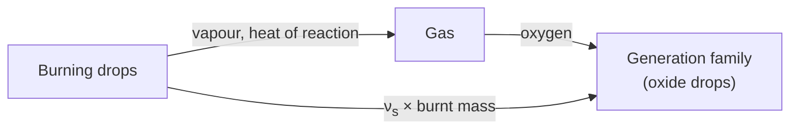

# Combustion

A burning drop loses its mass to the gas and gives it the heat of reaction. The symbols are those of
[Drag & Heat Transfer](drag-heat.md#notation).

!!! info "Switching it on"
    `combustion = direct` or `Beckstead`, and a row of the models file: see
    [Materials & Models](../user/models.md#combustion).

ICE has two burning models. Each material burns on its own.

| | Direct | Beckstead |
|---|---|---|
| Source | Gallier & Godfroy (2009) | Beckstead (2005), as IGLOO's parcels |
| Burns from | the burning temperature $T_{sat}$ | the ignition temperature $T_{ign}$ |
| Rate | $d^2$ law, with the heat of reaction in the transfer number | $d^n$ law |
| Drop temperature while burning | constant | follows its heat balance |

Both end at a residue, or burn out completely ([burn-out](#burn-out)). Both can make the oxide of a burning metal born
as drops of another family ([generated mass](#generated-mass)).

## Direct model

A burning drop vaporises at its saturation temperature, the vapour burns at once, and the heat of reaction goes to the
gas (Gallier & Godfroy, J. Propuls. Power 25(2), 2009, section II.A). It holds for any drop whose vapour burns in the
gas around it, not only aluminium.

**Burning rate.** The drop loses mass by the $d^2$ law of a vaporising drop, with the heat of reaction $Q$ in the
transfer number (unit Lewis number):

$$
\dot m = \pi d_p\,\frac{k_g}{c_{p,g}}\,Nu\,\ln(1 + B), \qquad
B = \frac{c_{p,g}\,(T_g - T_p) + Q}{L_v},
$$

with $L_v$ the material's latent heat at the burning temperature and $Nu$ from the chosen heat-transfer law. With
`Ranz-Marshall`, this is their eq. 4: the burning responds to the slip.

**Energy.** All the heat the drop receives feeds its vaporisation, $\dot Q = \dot m L_v$, so its temperature stays
constant while it burns. The gas receives, per unit volume and apart from the drag work,

$$
n\,\dot m\,\big(e_p(T_p) + \tfrac12|\mathbf u_p|^2 + Q\big).
$$

The first two terms are what the drops lose, as in evaporation. The heat of reaction $n\,\dot m\,Q$ is kept apart, in
the family's `heat` field: a gas of one species adds it to its energy, while a gas whose species carry their formation
enthalpies gains it from the change of species ([Coupling Interface](../development/coupling.md)).

**Burning time.** The number of drops does not change, so a drop shrinks as $d^2 = d_0^2 - K t$ with
$K = 8 k_g \ln(1 + B)/(c_{p,g}\,\rho_{al})$ at $Nu = 2$, and burns out in $d_0^2/K$ (their eq. 10).

!!! example "Aluminium"
    Gallier and Godfroy take $Q$ = 9.53 MJ/kg, $L_v$ = 10.8 MJ/kg and $T_{sat}$ = 2791 K.

## Beckstead model

At and above the ignition temperature $T_{ign}$ the drop burns by Beckstead's $d^n$ law, as IGLOO's parcels do:

$$
d^n = d_0^n - K X_{eff}\,t, \qquad \dot m = \rho_{al}\,\frac{\pi K X_{eff}}{2 n}\,d^{\,3-n},
$$

with $K$ the burning coefficient, $n$ the exponent (between 0 and 3) and $X_{eff}$ the oxidiser fraction.

- The law has no latent sink: the drop exchanges heat with the gas as an inert drop does.
- The drop keeps a share $\beta$ of the heat of reaction, which heats it; the gas pays that share through the drop's
  energy.
- ICE does not model the material a burning drop carries (IGLOO's carried material, an oxide cap for instance).

## Ignition and extinction

A drop burns only while three conditions hold:

| Condition | Otherwise |
|---|---|
| it is hot enough: $T_p \ge T_{sat}$ (direct) or $T_p \ge T_{ign}$ (Beckstead) | it is inert: drag, convection and radiation heat it like any drop, until it ignites |
| it is larger than the residue, $d_p > d_{res}$ | it stops: an inert residue of that diameter remains, the alumina of an aluminium drop |
| direct: the gas is hot enough to keep it burning, $B > 0$ | it stops burning |

These switches act at the end of a stage, which costs a little accuracy: a drop that ignites keeps the temperature
it reached in that stage (up to $\Delta t\,\mathrm{d}T/\mathrm{d}t$ above $T_{sat}$), and a residue can be up to
$K\Delta t/(2 d_{res})$ smaller than $d_{res}$. The temperature is compared within $10^{-10}$ of $T_{sat}$, so that
round-off does not switch off a drop held there.

## Burn-out

A material with no residue burns out. The number of drops has no sink in the equations, so the last drops of a cell
must leave together. ICE removes them in two ways, depending on the run.

**Time-accurate runs.** After the last stage of a step, a cell whose drops are burning is emptied when

- its drops are at or below the removal size (a diameter, or else a drop mass of $10^{-20}$ kg), or
- the step burnt as much as was left.

Every primitive goes to the empty state except the velocity, which stays: the flux upwinds at the mean of two cells'
velocities, and an emptied cell at rest would halve its inflow. What the cell held is kept as an amount for the gas
(`removed`); a coupler takes it and hands it to its gas over its own steps. Nothing is lost.

**Steady runs.** A removal at once has no fixed point, so the removal becomes a sink on the flux instead. Of what
leaves a cell whose burning drops are smaller than the removal size, a fraction $f$ burns at the cell's exit and goes
to the gas like any burn. $f$ rises as a cubic in the diameter, from 0 at 1.0 times the removal size to 1 at 0.9 times
it, so no cell's outflow jumps at a threshold. The flux of a face next to such a cell is blended toward its
first-order value by $f$.

A drop that does not burn is never removed, whatever its size.

## Generated mass

A burning metal can make a condensed oxide, a material of another ICE family: the **generated mass**. ICE running
alone generates none. A coupler that knows the reaction declares it: the material the oxide is,
and $\nu_s$, the kilograms of oxide per kilogram burnt.

The oxide takes its oxygen from the gas, so $\nu_s$ can exceed 1: aluminium makes 1.89 kg of alumina per kg burnt.

Drops that burn $\dot m_b$ per unit volume and time give the generation family, per unit volume and time,

$$
\dot M = \nu_s\,\dot m_b, \qquad \dot M\,\mathbf u_p, \qquad
\dot M\big(e_s(T_p) + \tfrac12|\mathbf u_p|^2\big), \qquad
\dot N = \frac{\dot M}{\tfrac{\pi}{6}\,\rho_s(T_p)\,d_s^3},
$$

its mass, momentum, energy and number of drops. The oxide is born with the burning drops' velocity and temperature;
$e_s$ and $\rho_s$ are its energy and density, and $d_s$ the diameter each oxide drop is born with.

**When it is born.** ICE steps its families one after the other, so the generated mass is collected first and born
afterwards:

1. In each stage of the burning family, the rates above are added to the step's sum with the weight the update gives
   the stage: $r_1$ (Euler), $(r_1 + r_2)/2$ (RK2), $r_1/6 + r_2/6 + 2r_3/3$ (RK3).
2. After every family has taken its step, the sum is born in the generation family:
    - in a time-accurate run, $\Delta t$ times it is added to the cells at once;
    - in a steady run, it becomes the births in force over every stage of the generation family's next step, so that
      the fixed point does not depend on either family's step.

Per cell and step, the generation family thus gains $\nu_s$ times the mass burnt, with that mass's momentum and the
birth energy. The gas does not receive it.

A burn-out (above) generates its oxide too, at the end of the step it ends. A coupler can also have mass born in a
family, the oxide of another solver's burning particles for instance. Both routes are described on the
[Coupling Interface](../development/coupling.md) page.

## The gas the burnt mass becomes

- **ICE running alone** takes the burning vapour to be the gas itself, as in the paper. The gas phase file must then
  declare one species.
- **A coupler that owns the gas** (hydra-MI2) tells ICE so before the set-up. ICE then reads no gas phase file, and the
  coupler gives the burnt mass the species of its reaction.
