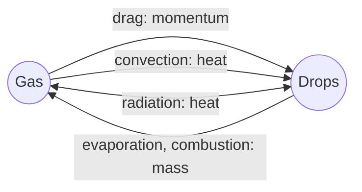

# Drag & Heat Transfer

The drops and the gas exchange momentum and heat in every cell where both are present. This page gives the
correlations ICE uses for drag, convective heat and radiation, and the notation the other physics pages share.

| Exchange | Models | Theory |
|---|---|---|
| Momentum | drag | [below](#drag) |
| Heat | convection, radiation | [below](#convective-heat-transfer) |
| Mass | evaporation, boiling | [Evaporation](evaporation.md) |
| Mass | combustion, generated mass | [Combustion](combustion.md) |
| Phase of the drop | freezing and melting | [Solidification](solidification.md) |

!!! info "Switching it on"
    Drag and heat transfer are chosen in `[ICE-Physics]`, radiation by the emissivity of each material:
    see [Materials & Models](../user/models.md#drag-and-heat-transfer).

## Notation

| Symbol | Meaning |
|---|---|
| $\rho_p$, $n$ | bulk density of the drops [kg/m³] and their number per unit volume [1/m³] |
| $\rho_{al}$ | density of the drop material itself [kg/m³] |
| $R_p$, $d_p$ | drop radius and diameter, from $\rho_p$, $n$ and $\rho_{al}$ |
| $\mathbf u_p$, $T_p$ | drop velocity and temperature (the mean temperature $\bar T$ when the drop is not uniform) |
| $\mathbf u_g$, $T_g$, $\rho_g$ | gas velocity, temperature and density |
| $\mu_g$, $k_g$, $c_{p,g}$ | gas viscosity, conductivity and specific heat |
| $\Delta\mathbf u = \mathbf u_g - \mathbf u_p$ | slip velocity |

## Dimensionless numbers

$$
Re = \frac{2\rho_g R_p |\Delta\mathbf u|}{\mu_g}, \qquad
Ma = \frac{|\Delta\mathbf u|}{\sqrt{\gamma R T_g}}, \qquad
Pr = \frac{\gamma}{\gamma-1}\frac{R\,\mu_g}{k_g}, \qquad
T_r = \frac{T_p}{T_g}.
$$

- $Re$ is built on the **diameter**.
- $T_r$ and $\gamma$ are used only by the compressible drag correlations.

## Drag

The drag coefficient $C_d$ sets the relaxation time of the drops,

$$
\tau_p = \frac{8\,\rho_{al}(T_p)\,R_p}{3\,\rho_g\,C_d\,|\Delta\mathbf u|}.
$$

The drops relax toward the gas velocity at that rate:

$$
\mathbf S_{\rho_p \mathbf u} = \rho_p \frac{\mathbf u_g - \mathbf u_p}{\tau_p},
$$

and the energy equation gains the matching work, $\rho_p\,\mathbf u_p\cdot(\mathbf u_g-\mathbf u_p)/\tau_p$.
With $C_d = 24/Re$ the relaxation time is exactly Stokes's, $\rho_{al}d_p^2/(18\mu_g)$.

| Name | $C_d$ | Notes |
|---|---|---|
| `Newton` | $0.45$ | Constant |
| `Stokes` | $24/Re$ | Creeping flow |
| `Schlichting` | $\frac{24}{Re}\left(1 + \frac{3}{16}Re\right)$ | Oseen correction |
| `Schiller-Naumann` | $\frac{24}{Re}\left(1+0.15\,Re^{0.687}\right)$ | Standard sub-critical fit |
| `Wen-Yu` | Schiller-Naumann for $Re \le 1000$, else $0.43$ | |
| `Putnam` | $\frac{24}{Re}\left(1+\frac{1}{6}Re^{2/3}\right)$ for $Re < 1000$, else $0.4392$ | |
| `Clift-Gauvin` | $\frac{24}{Re}\left(1+0.15Re^{0.687}+\frac{0.0175\,Re}{1+4.25\times10^{4}Re^{-1.16}}\right)$ | Valid through the drag crisis |
| `Morsi-Alexander` | $a_1 + a_2/Re + a_3/Re^2$ | Piecewise over eight $Re$ ranges; the first is exactly Stokes |
| `Carlson-Hoglund` | Wen-Yu times a rarefaction and compressibility factor in $Ma$ and $Re$ | |
| `Henderson` | Separate subsonic and supersonic fits, linearly bridged over $1 < Ma < 1.75$ | The bridge is continuous at both ends |
| `Crowe` | Wen-Yu blended towards $C_d = 2$ by $Ma$, with a $\tanh(\log_{10} Re)$ function | |
| `Hermsen` | Same structure as Crowe with a rational $Re$ function | |
| `NoDrag` | $0$ | No momentum exchange; the relaxation time is infinite |

Verification: [case A](../vv/verification/exchange.md#a-relaxation-under-stokes-drag) checks the Stokes limit, and
[case D](../vv/verification/exchange.md#d-every-drag-correlation) checks every correlation, including transonic and
supersonic slip for the four with a compressible branch.

## Convective heat transfer

Per unit volume, the drops of a cell receive

$$
\dot q_{\text{conv}} = 2\,Nu\;k_g\,\pi R_p\,n\,(T_g - T_p),
$$

the familiar $h A \Delta T$ with $h = Nu\,k_g/d_p$, summed over the $n$ drops.

| Name | $Nu$ | Limit as $Re \to 0$ |
|---|---|---|
| `Stokes` | $2$ | 2 |
| `JAXA1` | $2.5\,Re^{0.15} + 0.04\,Re$ | 0 |
| `JAXA2` | $2 + 0.37\,Re^{0.6}Pr^{1/3}$ | 2 |
| `JAXA3` | $2 + 0.459\,Re^{0.55}Pr^{1/3}$ (Chang) | 2 |
| `JAXA4` | $\left[\left(2+0.654\,Re^{1/2}Pr^{1/2}\right)^{-1} + \dfrac{3.42\,Ma}{Re\,Pr}\right]^{-1}$ | rarefaction-dependent |
| `Ranz-Marshall` | $2 + 0.6\,Re^{1/2}Pr^{1/3}$ | 2 |
| `Kavanau-Drake` | $\dfrac{N}{1 + 3.42\,Ma\,N/(Re\,Pr)}$, $N = 2+0.459\,Re^{0.55}Pr^{0.33}$ | rarefaction-dependent |
| `NoHeat` | $0$ | 0 (no convective exchange) |

!!! note "Sources of two correlations"
    Chang's correlation is `JAXA3`. The constant 0.654 and the exponent $Pr^{1/2}$ of `JAXA4` are those of the last
    row of NASA SP-8039, Table II; Shimada (2006, eq. 50) prints $Pr^{1/3}$.

## Radiation

$$
\dot q_{\text{rad}} = \varepsilon\,\sigma\,4\pi R_p^2\,n\,\big(T_g^4 - T_p^4\big),
\qquad \sigma = 5.670374419\times10^{-8}\ \mathrm{W\,m^{-2}\,K^{-4}}.
$$

- The drop exchanges over its whole surface, $4\pi R_p^2 = \pi d_p^2$.
- It exchanges with the local gas temperature, not with a wall or the far field.
- The emissivity $\varepsilon$ belongs to the material, and 0 switches radiation off. A property table with an
  `Emissivity` column gives $\varepsilon(T_p)$ at the drop temperature.
