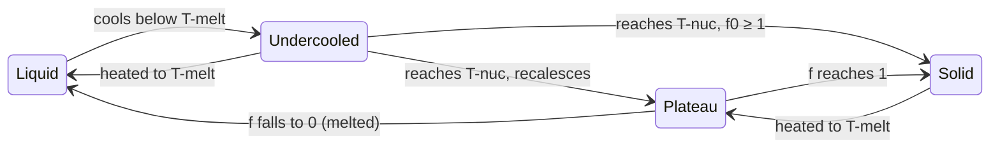
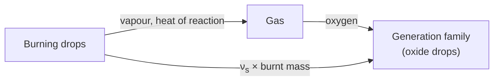

# Particle Physics

The drops and the gas exchange momentum, heat and mass. This page gives the models ICE uses for each exchange, cell
by cell:

| Exchange | Models |
|---|---|
| Momentum | [Drag](#drag) |
| Heat | [Convection](#convective-heat-transfer), [radiation](#radiation) |
| Mass | [Evaporation](#evaporation), [boiling](#boiling), [combustion](#combustion) |
| Phase of the drop | [Solidification](#solidification) |

How to switch each model on, and the values it needs, is on the [Input File](../user/input.md) page.

## Notation

| Symbol | Meaning |
|---|---|
| $\rho_p$, $n$ | bulk density of the drops [kg/m³] and their number per unit volume [1/m³] |
| $\rho_{al}$ | density of the drop material itself [kg/m³] |
| $R_p$, $d_p$ | drop radius and diameter, from $\rho_p$, $n$ and $\rho_{al}$ |
| $\mathbf u_p$, $T_p$ | drop velocity and temperature (the mean temperature $\bar T$ when the drop is not uniform) |
| $\mathbf u_g$, $T_g$, $\rho_g$ | gas velocity, temperature and density |
| $\mu_g$, $k_g$, $c_{p,g}$ | gas viscosity, conductivity and specific heat |
| $\Delta\mathbf u = \mathbf u_g - \mathbf u_p$ | slip velocity |

## Dimensionless numbers

$$
Re = \frac{2\rho_g R_p |\Delta\mathbf u|}{\mu_g}, \qquad
Ma = \frac{|\Delta\mathbf u|}{\sqrt{\gamma R T_g}}, \qquad
Pr = \frac{\gamma}{\gamma-1}\frac{R\,\mu_g}{k_g}, \qquad
T_r = \frac{T_p}{T_g}.
$$

- $Re$ is built on the **diameter**.
- $T_r$ and $\gamma$ are used only by the compressible drag correlations.

## Drag

The drag coefficient $C_d$ sets the relaxation time of the drops,

$$
\tau_p = \frac{8\,\rho_{al}(T_p)\,R_p}{3\,\rho_g\,C_d\,|\Delta\mathbf u|}.
$$

The drops relax toward the gas velocity at that rate:

$$
\mathbf S_{\rho_p \mathbf u} = \rho_p \frac{\mathbf u_g - \mathbf u_p}{\tau_p},
$$

and the energy equation gains the matching work, $\rho_p\,\mathbf u_p\cdot(\mathbf u_g-\mathbf u_p)/\tau_p$.
With $C_d = 24/Re$ the relaxation time is exactly Stokes's, $\rho_{al}d_p^2/(18\mu_g)$.

| Name | $C_d$ | Notes |
|---|---|---|
| `Newton` | $0.45$ | Constant |
| `Stokes` | $24/Re$ | Creeping flow |
| `Schlichting` | $\frac{24}{Re}\left(1 + \frac{3}{16}Re\right)$ | Oseen correction |
| `Schiller-Naumann` | $\frac{24}{Re}\left(1+0.15\,Re^{0.687}\right)$ | Standard sub-critical fit |
| `Wen-Yu` | Schiller-Naumann for $Re \le 1000$, else $0.43$ | |
| `Putnam` | $\frac{24}{Re}\left(1+\frac{1}{6}Re^{2/3}\right)$ for $Re < 1000$, else $0.4392$ | |
| `Clift-Gauvin` | $\frac{24}{Re}\left(1+0.15Re^{0.687}+\frac{0.0175\,Re}{1+4.25\times10^{4}Re^{-1.16}}\right)$ | Valid through the drag crisis |
| `Morsi-Alexander` | $a_1 + a_2/Re + a_3/Re^2$ | Piecewise over eight $Re$ ranges; the first is exactly Stokes |
| `Carlson-Hoglund` | Wen-Yu times a rarefaction and compressibility factor in $Ma$ and $Re$ | |
| `Henderson` | Separate subsonic and supersonic fits, linearly bridged over $1 < Ma < 1.75$ | The bridge is continuous at both ends |
| `Crowe` | Wen-Yu blended towards $C_d = 2$ by $Ma$, with a $\tanh(\log_{10} Re)$ function | |
| `Hermsen` | Same structure as Crowe with a rational $Re$ function | |
| `NoDrag` | $0$ | No momentum exchange; the relaxation time is infinite |

Verification: [case A](../vv/verification/exchange.md#a-relaxation-under-stokes-drag) checks the Stokes limit, and
[case D](../vv/verification/exchange.md#d-every-drag-correlation) checks every correlation, including transonic and
supersonic slip for the four with a compressible branch.

## Convective heat transfer

Per unit volume, the drops of a cell receive

$$
\dot q_{\text{conv}} = 2\,Nu\;k_g\,\pi R_p\,n\,(T_g - T_p),
$$

the familiar $h A \Delta T$ with $h = Nu\,k_g/d_p$, summed over the $n$ drops.

| Name | $Nu$ | Limit as $Re \to 0$ |
|---|---|---|
| `Stokes` | $2$ | 2 |
| `JAXA1` | $2.5\,Re^{0.15} + 0.04\,Re$ | 0 |
| `JAXA2` | $2 + 0.37\,Re^{0.6}Pr^{1/3}$ | 2 |
| `JAXA3` | $2 + 0.459\,Re^{0.55}Pr^{1/3}$ (Chang) | 2 |
| `JAXA4` | $\left[\left(2+0.654\,Re^{1/2}Pr^{1/2}\right)^{-1} + \dfrac{3.42\,Ma}{Re\,Pr}\right]^{-1}$ | rarefaction-dependent |
| `Ranz-Marshall` | $2 + 0.6\,Re^{1/2}Pr^{1/3}$ | 2 |
| `Kavanau-Drake` | $\dfrac{N}{1 + 3.42\,Ma\,N/(Re\,Pr)}$, $N = 2+0.459\,Re^{0.55}Pr^{0.33}$ | rarefaction-dependent |
| `NoHeat` | $0$ | 0 (no convective exchange) |

!!! note "Sources of two correlations"
    Chang's correlation is `JAXA3`. The constant 0.654 and the exponent $Pr^{1/2}$ of `JAXA4` are those of the last
    row of NASA SP-8039, Table II; Shimada (2006, eq. 50) prints $Pr^{1/3}$.

## Radiation

$$
\dot q_{\text{rad}} = \varepsilon\,\sigma\,4\pi R_p^2\,n\,\big(T_g^4 - T_p^4\big),
\qquad \sigma = 5.670374419\times10^{-8}\ \mathrm{W\,m^{-2}\,K^{-4}}.
$$

- The drop exchanges over its whole surface, $4\pi R_p^2 = \pi d_p^2$.
- It exchanges with the local gas temperature, not with a wall or the far field.
- The emissivity $\varepsilon$ belongs to the material, and 0 switches radiation off. A property table with an
  `Emissivity` column gives $\varepsilon(T_p)$ at the drop temperature.

## Evaporation

### What evaporation changes in a cell

Every model returns a rate $\dot m$ **per drop**, negative while the drop loses mass. Per unit volume, the cell's drops
then lose:

- the mass $n\,|\dot m|$;
- the momentum that mass carries;
- the energy that mass carries, plus the latent heat $L_v$ needed to vaporise it.

The number of drops does not change: drops shrink, they never disappear. Their radius always follows from $\rho_p$ and
$n$.

### The surface temperature

The vapour leaves at the surface temperature $T_s$, which every gas-side model takes. Usually $T_s$ is the mean
temperature $\bar T$. It differs from it in two cases: inside a drop with a temperature profile
([conduction inside the drop](#conduction-inside-the-drop)), and in a boiling drop ([boiling](#boiling)). Then the
energy of the cell reads

$$
\rho_p\frac{d\bar e}{dt} = n\left[\dot Q(T_s) + \dot Q_r(T_s) + \dot m(T_s)\,\big(L_v(T_s) + e(T_s) - e(\bar T)\big)\right],
\qquad \frac{d\rho_p}{dt} = n\,\dot m(T_s),
$$

with $e(T)$ the material's energy ($c\,T$, or the property table's). The vapour takes its enthalpy at $T_s$; the mean
temperature receives $e(\bar T) - e(T_s)$ per unit of evaporated mass.

### Saturation at the surface

All five models share one surface condition. The saturation pressure is the `Psat` column of the
[property table](../user/initial-conditions.md#property-table) when there is one (linear between nodes, constant beyond
the ends). Otherwise it is the Clausius-Clapeyron curve through the boiling point:

$$
p_{sat}(T_p) = p_{B}\,\exp\left[-\frac{L_v M_v}{\mathcal{R}}
  \left(\frac{1}{T_p} - \frac{1}{T_{boil}}\right)\right],
$$

with $M_v$ the vapour molar mass, $T_{boil}$ the boiling temperature and $p_B$ the pressure it is given at (one
atmosphere by default).

From the saturation pressure:

1. The surface mole fraction is $X_s = p_{sat}/p$. It is capped at $1 - 10^{-12}$ once $p_{sat}$ reaches the gas
   pressure, so that every model still returns a finite rate while the drop boils.
2. $X_s$ becomes a mass fraction $Y_s$, through the gas molar mass.
3. The Spalding mass-transfer number is

    $$
    B_M = \frac{Y_s - Y_\infty}{1 - Y_s}.
    $$

Evaporation stops when $Y_s$ falls to $Y_\infty$: a gas already saturated at the drop's temperature takes no more
vapour. The vapour diffusivity is $D_v = k_g/(\rho_g c_{p,g} Le)$, and $Sc = Pr\,Le$.

With the `Lv`, `Mv` and `Cpv` columns in the property table, $L_v$ and the vapour specific heat $c_{p,v}$ follow the
drop temperature wherever a model reads them, and $M_v$ is the column's value.

### Evaporation models

|  Model | $\dot m$ | Gas-side heat |
|---|---|---|
| **d2-law** | $-2\pi d\,\dfrac{k_g}{c_{p,g}}\ln(1+B_T)$, with $B_T = c_{p,g}(T_g-T_p)/L_v$ | Nusselt |
| **CEM** | $-\pi d\,\rho_g D_v\,Sh\,\ln(1+B_M)$, $Sh = 2+0.6\,Re^{1/2}Sc^{1/3}$ | Nusselt |
| **CEM-B** | CEM with $\rho_g$, $\mu_g$, $k_g$ re-evaluated at the 1/3-rule film temperature | Nusselt |
| **ASM** | CEM with $Sh^\star = 2 + (Sh_0-2)/F(B_M)$, $Sh_0$ Frössling, $F(B)=(1+B)^{0.7}\ln(1+B)/B$ | its own |
| **TC** | $-\pi d\,\rho_g D_v\,Sh\,\hat m$, $\hat m$ from a monotone transcendental solved by Newton | its own |

- `d2-law` is the classical Godsave-Spalding stagnant-film rate, the only model driven by the thermal Spalding number.
- `CEM` adds the Ranz-Marshall convective correction; `CEM-B` adds the Hubbard film rule on top.
- `ASM` (Abramzon-Sirignano) and `TC` (Tonini-Cossali) compute the gas-side heat inside their own film, Stefan flow
  included. That heat replaces the Nusselt one.

### Non-equilibrium interface

The Langmuir-Knudsen interface (Miller-Harstad-Bellan model M2) replaces the equilibrium surface condition. A Knudsen
layer lowers the surface mole fraction in proportion to the evaporation rate itself:

$$
X_s = X_{s,eq} - \frac{2L_K}{d}\beta, \qquad
\beta = -\frac{\dot m\,Pr}{2\pi\mu_g d}.
$$

$\alpha_e$ in $L_K$ is the accommodation coefficient. The relation is implicit in $\dot m$; a damped fixed-point
iteration solves it. Since $L_K/d$ grows as the drop shrinks, the effect grows over a drop's life.

### Stefan blowing

The outgoing vapour thickens the thermal film and reduces the convective heat by the Miller-Harstad-Bellan factor

$$
f_2 = \frac{b}{e^{b}-1}, \qquad b = -\frac{3}{2}\,Pr\,\tau_p\,\frac{\dot m}{m_p}.
$$

It applies only where the Nusselt correlation is in use, so not under `ASM` and `TC`. $f_2 \to 1$ as the rate
vanishes.

!!! note "`d2-law` with $Nu = 2$ and blowing keeps the drop temperature fixed"
    Substituting the $d^2$-law rate into $b$ cancels every property and leaves $b = \ln(1+B_T)$, so
    $f_2 = \ln(1+B_T)/B_T$. The blown convective heat $2\pi d k_g (T_g-T_p) f_2$ then equals the latent sink
    $-\dot m L_v$ exactly, for any gas, material and drop temperature. The drop temperature stays fixed and the
    textbook $d^2$ law is reproduced exactly:
    [case F](../vv/verification/phase-change.md#an-exact-check-with-nothing-frozen) uses this as its sharpest check.

### Conduction inside the drop

By default (`ITC`) a drop has one uniform temperature. Under `P2T` its temperature is parabolic in the radius
(Dombrovsky & Sazhin 2003):

$$
T(r) = T_c + (T_s - T_c)\,(r/R)^2, \qquad \bar T = \frac{2T_c + 3T_s}{5}.
$$

**Surface temperature.** The heat the liquid conducts inward at the surface is the heat the surface absorbs. That
balance fixes $T_s$:

$$
T_s - \bar T = \frac{\dot Q_{net}(T_s)}{10\pi\,k_{eff}\,d}, \qquad
\dot Q_{net}(T) = \dot Q_g(T) + \dot Q_r(T) + \dot m(T)\,L_v(T),
$$

where $\dot Q_g = \pi d\,k_g\,Nu\,(T_g - T)$ is the convective heat (times $f_2$ with Stefan blowing, or the model's
own heat under ASM and TC), $\dot Q_r$ the radiative exchange, and $\dot m$ the evaporation rate with the surface
state at $T$.

**Circulation inside the drop.** A drop in a slip flow circulates inside, which raises its effective conductivity to
$k_{eff} = \chi\,k_l$ (Abramzon & Sirignano 1989, eqs. 30, 32, 39):

$$
U_s = \frac{12.69}{32}\,|\Delta u|\,\frac{\mu_g}{\mu_l}\,\frac{Re^{1/3}}{1 + B_M}, \qquad
Pe_L = \frac{U_s\,d\,\rho_l\,c_l}{k_l}, \qquad
\chi = 1.86 + 0.86\tanh\left[2.245\log_{10}\frac{Pe_L}{30}\right],
$$

with $\chi = 1$ without slip. $k_l$ and $\mu_l$ are the liquid conductivity and viscosity (`k-liq`, `mu-liq`, or the
`Conductivity` and `Viscosity` columns). $\rho_l$, $c_l$ and $k_l$ are taken at $\bar T$, and $\mu_l$ at the surface
temperature, as Abramzon & Sirignano do.

**How $T_s$ is found.** Brent's method solves the balance, to $4\varepsilon$ in at most 100 evaluations. The
bracket starts between $\bar T$ and $\bar T + \dot Q_{net}(\bar T)/(10\pi k_{eff} d)$ and widens to $T_g$ for a heated
drop, or to the low end for a cooled one. Every gas-side quantity then takes $T_s$: $p_{sat}$, $Y_s$, $B_M$, $L_v$ and
$c_{p,v}$, the convective and radiative heats, and the temperature ratio of the drag laws. The density, the diameter
and the energy stay at $\bar T$.

**A closed form.** At $Re = 0$ without mass transfer, $T_s = (5\bar T + \zeta T_g)/(5 + \zeta)$ with
$\zeta = Nu\,k_g/(2k_l)$, and $\bar T$ relaxes with the time constant $\tau_{ITC}(1 + \zeta/5)$.

**Edge cases.**

- A cell below the empty-cell density keeps $T_s = \bar T$.
- A surface balance with no root gives $T_s$ = NaN. The run then stops on the invalid state after the update and
  names the cell: ICE has no step rejection to retry it with.

### Boiling

By default (`clamp`) the surface vapour fraction stays below 1 at any temperature. Under `ZGR` (Zuo, Gomes & Rutland
2000) a drop **boils** once its mean temperature reaches the boiling temperature at the gas pressure,
$\bar T \ge T_B(p)$ with $p = \rho_g R_g T_g$. $T_B$ inverts the Clausius-Clapeyron curve,

$$
T_B = \left(\frac{1}{T_{boil,1}} - \frac{\mathcal{R}}{L_v M_v}\ln\frac{p}{p_{atm}}\right)^{-1},
$$

with $T_{boil,1}$ the boiling temperature at one atmosphere, on the same curve:
$1/T_{boil,1} = 1/T_{boil} + \ln(p_B/p_{atm})\,\mathcal{R}/(L_v M_v)$. With a `Psat` column, $T_B$ inverts the column
instead: a column below $p$ at its last node has no boiling regime, and one at or above $p$ at its first node gives
$T_{min}$.

Below $T_B$ the material's evaporation model runs as usual.

While the drop boils, its surface sits at $T_B$ and two mechanisms vaporise it.

**The flash, fed by the superheat.** With $\Delta T = \bar T - T_B$ and $\Delta T_f = \max(\Delta T, 0.5\ \mathrm{K})$,

$$
G_f = \frac{\alpha_s\,\Delta T_f\,\pi d^2}{L_v}, \qquad
\alpha_s = 760\,\Delta T_f^{0.26}\ (\Delta T_f < 5),\quad 27\,\Delta T_f^{2.33}\ (< 25),\quad
13800\,\Delta T_f^{0.39}\ \mathrm{W\,m^{-2}\,K^{-1}}.
$$

A `P2T` drop takes its parabolic conduction instead, $G_f = 10\pi k_l d\,\Delta T_f/L_v$.

**The heat from the gas**, through the film the vapour blows. With $A = c_{p,g}(T_g - T_B)/L_v$, the film
conductivity $k_f = k_g (T_f/T_g)^{0.7}$ at $T_f = T_B + (T_g - T_B)/3$, and $B = \pi k_f d\,Nu/c_{p,g}$, the
heat-fed rate $G$ solves

$$
G\,(1 + G_f/G) = B\ln\big(1 + A(1 + G_f/G)\big)
$$

($G = 0$ for $A \le 0$). With $S = G + G_f$ the drop then loses mass and receives heat as

$$
\dot m = -S, \qquad \dot Q_s = \frac{S\,c_{p,g}(T_g - T_B)}{e^{S/B} - 1},
$$

$\dot Q_s$ replacing the convective heat. It is negative for a gas colder than $T_B$ and 0 at $T_g = T_B$, the
adiabatic flash. $L_v$ and the radiative exchange are taken at $T_B$; the interface and blowing models do not act while
the drop boils.

!!! warning "The time step near the boiling temperature"
    Just below $T_B$ the evaporation rate is far larger than just above it. On a 20 µm water drop in a gas at $T_B$,
    $d\bar T/dt = -7.7\times10^6$ K/s at $10^{-6}$ K below, against $-24$ K/s at 0.1 K above. A step that carries a
    drop across $T_B$ overshoots, the more the longer the step, and can even leave a negative density.

    Under `ZGR`, ICE watches the fraction $\Delta t\,|S_1|/\rho_p$ of a cell's drop mass that one step removes. The
    first time it exceeds 0.5 for a family, ICE warns once:

        [WARNING] boiling = ZGR, family 
 (material <m>, rank <r>): at iteration <n>, time <t>, a step removes <f> of a
        cell's drop mass (more than 0.5): the step does not resolve the evaporation at the boiling temperature and the
        result is not trusted; lower dt-max

    The run goes on. The warning has two causes: a drop crossing $T_B$ with too long a step, or a cell whose drops
    evaporate completely within one step. In the first case the solution is not to be trusted: lower `dt-max`. On the drop above, the fraction is 0.012 at `dt-max` = 1e-6 s and 0.37 at 4e-5 s, where the result is
    still right; at 5e-5 s it is 0.57 and the mean temperature undershoots to 382 K.

## Solidification

A material with solidification on freezes and melts:

- a molten drop **supercools**, **recalesces**, **freezes** on a plateau at the melting point and cools as a solid;
- a solid or partly frozen drop heated past the melting point **melts** there.

Its families carry two more variables after $n_p$, both carried with the mass: the frozen fraction $f$ and the
nucleated fraction $\chi$.

### Energy with latent heat

The latent heat is part of the energy per unit mass:

$$
e(T, f) = c_l\,T - f\,L(T), \qquad L(T) = h_{fus} - (c_l - c_s)(T_m - T),
$$

with $c_l$ the liquid's specific heat, $c_s$ the solid's, $h_{fus}$ the heat of fusion and $T_m$ the melting
temperature: a fraction $f$ of solid and $1 - f$ of liquid at one temperature. With a `Cp` column that varies,
$c_l T$ becomes the table's liquid energy $e_l(T)$ and $L(T) = h_{fus} - \big(e_l(T_m) - e_l(T)\big) + c_s(T_m - T)$.

### Liquid, plateau or solid

After every update, $T_p$ and $f$ follow from the energy and $\chi$. Let $T_\ell = e/c_l$ be the temperature the
content would have if it were all liquid:

| Energy | $\chi$ | State |
|---|---|---|
| $T_\ell \ge T_m$ | any | liquid, $T_p = T_\ell$, $f = 0$; $\chi$ is cleared |
| $T_\ell \le T_{nuc}$ | any | nucleated; $\chi$ is set to 1 |
| $T_{nuc} < T_\ell < T_m$ | $\ge \tfrac12$ | nucleated; $\chi$ kept |
| $T_{nuc} < T_\ell < T_m$ | $< \tfrac12$ | undercooled liquid, $T_p = T_\ell$, $f = 0$; $\chi$ kept |

A nucleated content follows the lever rule at $T_m$:

- **plateau**, while $f = c_l(T_m - T_\ell)/h_{fus}$ is below 1: $T_p = T_m$;
- **solid** otherwise: $f = 1$ and $T_p = T_m - \big(c_l(T_m - T_\ell) - h_{fus}\big)/c_s$.

### The freezing path

1. A liquid supercools down to the nucleation temperature $T_{nuc}$.
2. It recalesces at constant energy: to the plateau with $f_0 = c_l(T_m - T_{nuc})/h_{fus}$, or straight to the
   solid when $f_0 \ge 1$. The recalescence exchanges nothing with the gas.
3. It freezes on the plateau at the rate the gas takes its heat, $h_{fus}\,\mathrm{d}f/\mathrm{d}t = -\dot q/\rho_p$.
4. It cools as a solid.

Heated, a nucleated content warms as a solid to $T_m$, melts on the plateau at the same rate and is liquid again at
$f = 0$. Nothing is solid above $T_m$, and a melted content supercools again before it refreezes.

### Why the nucleated fraction is carried

$\chi$ is the fraction of a cell's mass that has nucleated and not completely melted since. Nucleation sets it,
complete melting clears it, and otherwise it is only carried with the mass. A cell therefore follows the history of
what flows through it: liquid flowing into a cell that once nucleated replaces its content and returns it to the
liquid.

The frozen fraction could not hold that memory: it is computed from the energy, so a nucleated cell would rebuild it
every step and nucleate all the liquid that enters.

### Accuracy

**In time.** Along a single history (a closed cell) the formulation reproduces the particle model exactly. Its one
time-step error is the nucleation switch, at the end of a stage: the plateau is shifted by at most
$\pi d_p k_g Nu\,(T_m - T_{nuc})\,\Delta t/(m h_{fus})$ in $f$. Melting has no such error.

**In space.** In a steady stream the nucleation front and both melting points are located within one cell. The
reconstruction works on $T_\ell$ instead of $T_p$ ([Reconstruction](numerics.md#reconstruction)), which has no jump at
the nucleation front, so a steady run converges there with MUSCL as at first order. Two approximations remain:

- a cell where contents of different histories meet ($0 < \chi < 1$) holds one state, decided by the majority;
- when the inflow of the front cell lies in a narrow window, both its liquid and its nucleated state can be steady,
  which puts the front one cell earlier or later.

**Leak upstream.** The Rusanov and HLLE fluxes leak $\chi$ upstream of a sharp front, with $u$ the flow speed and $c$
the closure's signal speed:

| Flux | Leak into the first upstream cell (first order) | No cell flips while |
|---|---|---|
| Rusanov | $c/(2u + c)$, about half that with MUSCL | $c < 2u$ |
| HLLE | none while $c \le u$, else $(c - u)/(c + u)$ | $c < 3u$ |

Beyond these bounds one or two cells upstream of the front nucleate and the front moves by that much, no further. An
IG or AG stream injected at the inlet's pseudo-pressure ($P = 10^{-6}$) is far below them unless its bulk density is
tiny.

### Limits

- The density of the material must be constant (its specific heat may vary).
- A material that solidifies does not evaporate or burn.

!!! example "Alumina"
    The NIST-JANAF tables give $T_m$ = 2327 K, $h_{fus}$ = 1.09 MJ/kg, and at the melting point a liquid specific
    heat of 1.89 kJ/(kg K) and a solid one of 1.36 kJ/(kg K).

## Combustion

ICE has two burning models. Each material burns on its own.

| | Direct | Beckstead |
|---|---|---|
| Source | Gallier & Godfroy (2009) | Beckstead (2005), as IGLOO's parcels |
| Burns from | the burning temperature $T_{sat}$ | the ignition temperature $T_{ign}$ |
| Rate | $d^2$ law, with the heat of reaction in the transfer number | $d^n$ law |
| Drop temperature while burning | constant | follows its heat balance |

Both end at a residue, or burn out completely ([burn-out](#burn-out)). Both can make the oxide of a burning metal born
as drops of another family ([generated mass](#generated-mass)).

### Direct model

A burning drop vaporises at its saturation temperature, the vapour burns at once, and the heat of reaction goes to the
gas (Gallier & Godfroy, J. Propuls. Power 25(2), 2009, section II.A). It holds for any drop whose vapour burns in the
gas around it, not only aluminium.

**Burning rate.** The drop loses mass by the $d^2$ law of a vaporising drop, with the heat of reaction $Q$ in the
transfer number (unit Lewis number):

$$
\dot m = \pi d_p\,\frac{k_g}{c_{p,g}}\,Nu\,\ln(1 + B), \qquad
B = \frac{c_{p,g}\,(T_g - T_p) + Q}{L_v},
$$

with $L_v$ the material's latent heat at the burning temperature and $Nu$ from the chosen heat-transfer law. With
`Ranz-Marshall`, this is their eq. 4: the burning responds to the slip.

**Energy.** All the heat the drop receives feeds its vaporisation, $\dot Q = \dot m L_v$, so its temperature stays
constant while it burns. The gas receives, per unit volume and apart from the drag work,

$$
n\,\dot m\,\big(e_p(T_p) + \tfrac12|\mathbf u_p|^2 + Q\big).
$$

The first two terms are what the drops lose, as in evaporation. The heat of reaction $n\,\dot m\,Q$ is kept apart, in
the family's `heat` field: a gas of one species adds it to its energy, while a gas whose species carry their formation
enthalpies gains it from the change of species ([Coupling Interface](../development/coupling.md)).

**Burning time.** The number of drops does not change, so a drop shrinks as $d^2 = d_0^2 - K t$ with
$K = 8 k_g \ln(1 + B)/(c_{p,g}\,\rho_{al})$ at $Nu = 2$, and burns out in $d_0^2/K$ (their eq. 10).

!!! example "Aluminium"
    Gallier and Godfroy take $Q$ = 9.53 MJ/kg, $L_v$ = 10.8 MJ/kg and $T_{sat}$ = 2791 K.

### Beckstead model

At and above the ignition temperature $T_{ign}$ the drop burns by Beckstead's $d^n$ law, as IGLOO's parcels do:

$$
d^n = d_0^n - K X_{eff}\,t, \qquad \dot m = \rho_{al}\,\frac{\pi K X_{eff}}{2 n}\,d^{\,3-n},
$$

with $K$ the burning coefficient, $n$ the exponent (between 0 and 3) and $X_{eff}$ the oxidiser fraction.

- The law has no latent sink: the drop exchanges heat with the gas as an inert drop does.
- The drop keeps a share $\beta$ of the heat of reaction, which heats it; the gas pays that share through the drop's
  energy.
- ICE does not model the material a burning drop carries (IGLOO's carried material, an oxide cap for instance).

### Ignition and extinction

A drop burns only while three conditions hold:

| Condition | Otherwise |
|---|---|
| it is hot enough: $T_p \ge T_{sat}$ (direct) or $T_p \ge T_{ign}$ (Beckstead) | it is inert: drag, convection and radiation heat it like any drop, until it ignites |
| it is larger than the residue, $d_p > d_{res}$ | it stops: an inert residue of that diameter remains, the alumina of an aluminium drop |
| direct: the gas is hot enough to keep it burning, $B > 0$ | it stops burning |

These switches act at the end of a stage, which costs a little accuracy: a drop that ignites keeps the temperature
it reached in that stage (up to $\Delta t\,\mathrm{d}T/\mathrm{d}t$ above $T_{sat}$), and a residue can be up to
$K\Delta t/(2 d_{res})$ smaller than $d_{res}$. The temperature is compared within $10^{-10}$ of $T_{sat}$, so that
round-off does not switch off a drop held there.

### Burn-out

A material with no residue burns out. The number of drops has no sink in the equations, so the last drops of a cell
must leave together. ICE removes them in two ways, depending on the run.

**Time-accurate runs.** After the last stage of a step, a cell whose drops are burning is emptied when

- its drops are at or below the removal size (a diameter, or else a drop mass of $10^{-20}$ kg), or
- the step burnt as much as was left.

Every primitive goes to the empty state except the velocity, which stays: the flux upwinds at the mean of two cells'
velocities, and an emptied cell at rest would halve its inflow. What the cell held is kept as an amount for the gas
(`removed`); a coupler takes it and hands it to its gas over its own steps. Nothing is lost.

**Steady runs.** A removal at once has no fixed point, so the removal becomes a sink on the flux instead. Of what
leaves a cell whose burning drops are smaller than the removal size, a fraction $f$ burns at the cell's exit and goes
to the gas like any burn. $f$ rises as a cubic in the diameter, from 0 at 1.0 times the removal size to 1 at 0.9 times
it, so no cell's outflow jumps at a threshold. The flux of a face next to such a cell is blended toward its
first-order value by $f$.

A drop that does not burn is never removed, whatever its size.

### Generated mass

A burning metal can make a condensed oxide, a material of another ICE family: the **generated mass**. ICE running
alone generates none. A coupler that knows the reaction declares it (`set_generation`): the material the oxide is,
and $\nu_s$, the kilograms of oxide per kilogram burnt.

The oxide takes its oxygen from the gas, so $\nu_s$ can exceed 1: aluminium makes 1.89 kg of alumina per kg burnt.

Drops that burn $\dot m_b$ per unit volume and time give the generation family, per unit volume and time,

$$
\dot M = \nu_s\,\dot m_b, \qquad \dot M\,\mathbf u_p, \qquad
\dot M\big(e_s(T_p) + \tfrac12|\mathbf u_p|^2\big), \qquad
\dot N = \frac{\dot M}{\tfrac{\pi}{6}\,\rho_s(T_p)\,d_s^3},
$$

its mass, momentum, energy and number of drops. The oxide is born with the burning drops' velocity and temperature;
$e_s$ and $\rho_s$ are its energy and density, and $d_s$ the diameter each oxide drop is born with.

**When it is born.** ICE steps its families one after the other, so the generated mass is collected first and born
afterwards:

1. In each stage of the burning family, the rates above are added to the step's sum with the weight the update gives
   the stage: $r_1$ (Euler), $(r_1 + r_2)/2$ (RK2), $r_1/6 + r_2/6 + 2r_3/3$ (RK3).
2. After every family has taken its step, the sum is born in the generation family:
    - in a time-accurate run, $\Delta t$ times it is added to the cells at once;
    - in a steady run, it becomes the births in force over every stage of the generation family's next step, so that
      the fixed point does not depend on either family's step.

Per cell and step, the generation family thus gains $\nu_s$ times the mass burnt, with that mass's momentum and the
birth energy. The gas does not receive it.

A burn-out (above) generates its oxide too, at the end of the step it ends. A coupler can also have mass born in a
family, the oxide of another solver's burning particles for instance. Both routes are described on the
[Coupling Interface](../development/coupling.md) page.

### The gas the burnt mass becomes

- **ICE running alone** takes the burning vapour to be the gas itself, as in the paper. The gas phase file must then
  declare one species.
- **A coupler that owns the gas** (hydra-MI2) tells ICE so before the set-up. ICE then reads no gas phase file, and the
  coupler gives the burnt mass the species of its reaction.
