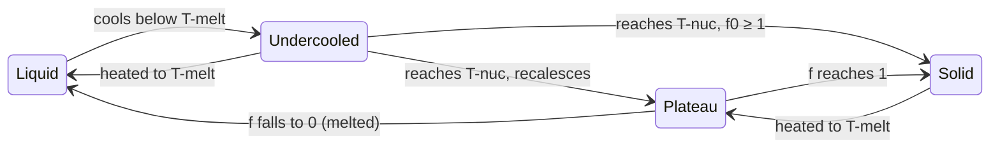

# Solidification

A material with solidification on freezes and melts:

- a molten drop **supercools**, **recalesces**, **freezes** on a plateau at the melting point and cools as a solid;
- a solid or partly frozen drop heated past the melting point **melts** there.

Its families carry two more variables after $n_p$, both carried with the mass: the frozen fraction $f$ and the
nucleated fraction $\chi$. The other symbols are those of [Drag & Heat Transfer](drag-heat.md#notation).

!!! info "Switching it on"
    `solidification=on` on a material's line: see [Materials & Models](../user/models.md#solidification).

## Energy with latent heat

The latent heat is part of the energy per unit mass:

$$
e(T, f) = c_l\,T - f\,L(T), \qquad L(T) = h_{fus} - (c_l - c_s)(T_m - T),
$$

with $c_l$ the liquid's specific heat, $c_s$ the solid's, $h_{fus}$ the heat of fusion and $T_m$ the melting
temperature: a fraction $f$ of solid and $1 - f$ of liquid at one temperature. With a `Cp` column that varies,
$c_l T$ becomes the table's liquid energy $e_l(T)$ and $L(T) = h_{fus} - \big(e_l(T_m) - e_l(T)\big) + c_s(T_m - T)$.

## Liquid, plateau or solid

After every update, $T_p$ and $f$ follow from the energy and $\chi$. Let $T_\ell = e/c_l$ be the temperature the
content would have if it were all liquid:

| Energy | $\chi$ | State |
|---|---|---|
| $T_\ell \ge T_m$ | any | liquid, $T_p = T_\ell$, $f = 0$; $\chi$ is cleared |
| $T_\ell \le T_{nuc}$ | any | nucleated; $\chi$ is set to 1 |
| $T_{nuc} < T_\ell < T_m$ | $\ge \tfrac12$ | nucleated; $\chi$ kept |
| $T_{nuc} < T_\ell < T_m$ | $< \tfrac12$ | undercooled liquid, $T_p = T_\ell$, $f = 0$; $\chi$ kept |

A nucleated content follows the lever rule at $T_m$:

- **plateau**, while $f = c_l(T_m - T_\ell)/h_{fus}$ is below 1: $T_p = T_m$;
- **solid** otherwise: $f = 1$ and $T_p = T_m - \big(c_l(T_m - T_\ell) - h_{fus}\big)/c_s$.

## The freezing path

1. A liquid supercools down to the nucleation temperature $T_{nuc}$.
2. It recalesces at constant energy: to the plateau with $f_0 = c_l(T_m - T_{nuc})/h_{fus}$, or straight to the
   solid when $f_0 \ge 1$. The recalescence exchanges nothing with the gas.
3. It freezes on the plateau at the rate the gas takes its heat, $h_{fus}\,\mathrm{d}f/\mathrm{d}t = -\dot q/\rho_p$.
4. It cools as a solid.

Heated, a nucleated content warms as a solid to $T_m$, melts on the plateau at the same rate and is liquid again at
$f = 0$. Nothing is solid above $T_m$, and a melted content supercools again before it refreezes.

## Why the nucleated fraction is carried

$\chi$ is the fraction of a cell's mass that has nucleated and not completely melted since. Nucleation sets it,
complete melting clears it, and otherwise it is only carried with the mass. A cell therefore follows the history of
what flows through it: liquid flowing into a cell that once nucleated replaces its content and returns it to the
liquid.

The frozen fraction could not hold that memory: it is computed from the energy, so a nucleated cell would rebuild it
every step and nucleate all the liquid that enters.

## Accuracy

**In time.** Along a single history (a closed cell) the formulation reproduces the particle model exactly. Its one
time-step error is the nucleation switch, at the end of a stage: the plateau is shifted by at most
$\pi d_p k_g Nu\,(T_m - T_{nuc})\,\Delta t/(m h_{fus})$ in $f$. Melting has no such error.

**In space.** In a steady stream the nucleation front and both melting points are located within one cell. The
reconstruction works on $T_\ell$ instead of $T_p$ ([Reconstruction](numerics.md#reconstruction)), which has no jump at
the nucleation front, so a steady run converges there with MUSCL as at first order. Two approximations remain:

- a cell where contents of different histories meet ($0 < \chi < 1$) holds one state, decided by the majority;
- when the inflow of the front cell lies in a narrow window, both its liquid and its nucleated state can be steady,
  which puts the front one cell earlier or later.

**Leak upstream.** The Rusanov and HLLE fluxes leak $\chi$ upstream of a sharp front, with $u$ the flow speed and $c$
the closure's signal speed:

| Flux | Leak into the first upstream cell (first order) | No cell flips while |
|---|---|---|
| Rusanov | $c/(2u + c)$, about half that with MUSCL | $c < 2u$ |
| HLLE | none while $c \le u$, else $(c - u)/(c + u)$ | $c < 3u$ |

Beyond these bounds one or two cells upstream of the front nucleate and the front moves by that much, no further. An
IG or AG stream injected at the inlet's pseudo-pressure ($P = 10^{-6}$) is far below them unless its bulk density is
tiny.

## Limits

- The density of the material must be constant (its specific heat may vary).
- A material that solidifies does not evaporate or burn.

!!! example "Alumina"
    The NIST-JANAF tables give $T_m$ = 2327 K, $h_{fus}$ = 1.09 MJ/kg, and at the melting point a liquid specific
    heat of 1.89 kJ/(kg K) and a solid one of 1.36 kJ/(kg K).
