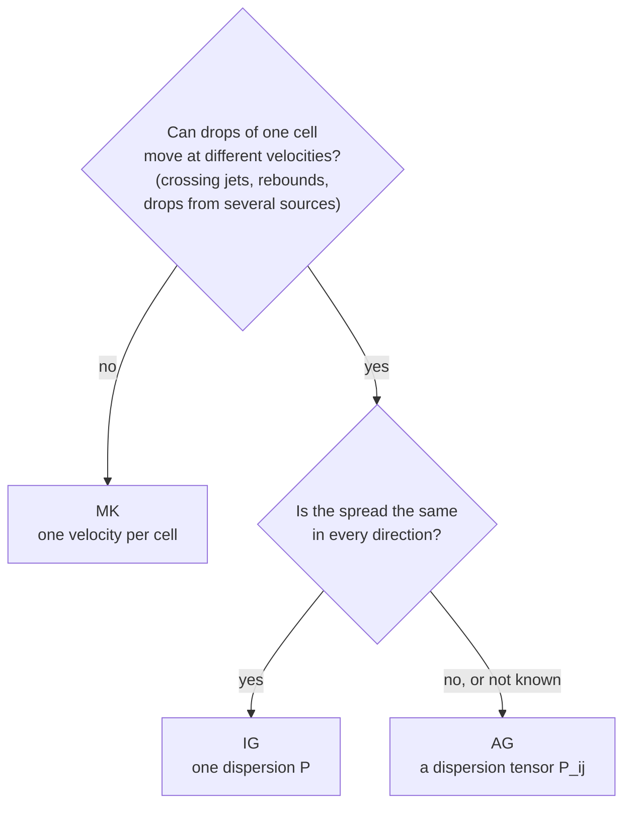

# Families & Closures

ICE solves the drops as one or more **families**. A family is a population of drops of one material with its own state
on the mesh. Its **closure** sets how much of the drops' velocity spread it carries.

---

## Declaring families

One `[ICE-FamilyN]` section per family, numbered from 1. ICE stops at the first missing number, and a file with no
family stops the run.

```ini
[ICE-Family1]
closure = MK

[ICE-Family2]
closure = AG
```

| Key | Values | Required |
|---|---|---|
| `closure` | `MK`, `IG`, `AG` | yes |

The families share the mesh, the gas field and the scheme. Each has its own state, and they do not interact, except
for the [generated mass](../theory/combustion.md#generated-mass) a burning family can give another. A polydisperse
cloud is one family per size.

---

## Choosing the closure



| Closure | Velocities in a cell | Variables | Two crossing streams | Default Riemann solver |
|---|---|---|---|---|
| `MK`, monokinetic | one | 6 | merge into a $\delta$-shock | `Saurel` |
| `IG`, isotropic Gaussian | spread equally in every direction | 7 | merge, then spread as one jet | `Rusanov` |
| `AG`, anisotropic Gaussian | spread differently by direction | 12 | cross, diffused | `Rusanov` |

- **MK** is the cheapest and right for a cloud that follows the gas, or one stream. Where streams cross it piles them
  up into one.
- **IG** and **AG** add a velocity dispersion that acts like a pressure, with its own signal speed. AG lets two streams
  cross; it costs twice MK's variables.
- `riemann-solver = Saurel` works with MK only: ICE refuses it for an IG or AG family
  ([Numerics](numerics.md#riemann-solver)).
- A coupled IG or AG run with `RK2` wants `tau-factor = 0.5` ([Numerics](numerics.md#the-time-step)).

The equations of each closure are in [Governing Equations](../theory/governing-equations.md#the-closure-problem), and
the crossing-jets test in [Crossing Jets](../vv/crossing-jets.md).

---

## Families and materials

Each family is made of one material. The [phase file](models.md#the-phase-file) gives each material a number of groups,
and the families take the materials in order:

```text
condensed-dispersed phase
A 1
B 2
```

Here family 1 is material A, and families 2 and 3 are material B. The groups must add up to the number of families.
Without the phase file every family is made of one material.

| Families | Phase file | Property table |
|---|---|---|
| any number, one material | optional | optional |
| several materials | one line per material | required, one zone per material ([Material Properties](properties.md#the-property-table)) |

Each family takes its initial state from `part-ic.tec` ([Initial Conditions](initial-conditions.md#variable-order)) and
its inlets from its own copy of the boundary table ([Several families](boundary-conditions.md#several-families)).

A material whose line asks for solidification adds two variables to each of its families
([Solidification](../theory/solidification.md)).
