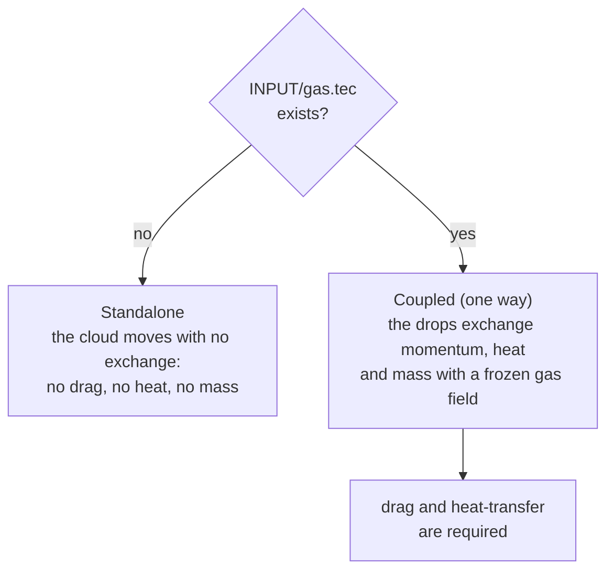

# Run Settings

What kind of run ICE makes, when it stops, what it writes, and how it takes new settings while it runs. The keys are
in `[ICE-Parameters]` and `[ICE-IO]`.

---

## Standalone or coupled

There is no key for it: **the gas field decides**.

| | Standalone | Coupled |
|---|---|---|
| Switched on by | no gas file | `INPUT/gas.tec` (`.szplt` or `.vtm` after `ic-format`) |
| Exchange models | not read | `drag` and `heat-transfer` required, the others as asked ([Materials & Models](models.md)) |
| The gas | none | read once, never changed by ICE |
| `tau-factor` | not used | bounds the step by the relaxation time ([Numerics](numerics.md#the-time-step)) |

`gas-path` in `[ICE-IO]` changes the folder ICE looks in (default `INPUT/`). Inside hydra, the coupler hands ICE the
gas at every step instead: see [Coupling Interface](../development/coupling.md).

---

## When the run stops

The run stops at the first of three thresholds, in `[ICE-Parameters]`:

| Key | Stops when | Default |
|---|---|---|
| `iter-threshold` | the iterations reach it | never, in practice |
| `time-threshold` | the simulation time reaches it | never, in practice |
| `res-threshold` | the density residual has fallen by this factor (steady runs only) | $10^{-10}$ |

A steady run with no threshold set stops on the residual; `res-threshold = 0` switches that test off. A time-accurate
run ignores it: the change of one time step says nothing about convergence.

`res-threshold` is **relative**: it compares the density residual (column 3 of the
[residual history](using.md#the-residual-history)) with the first non-zero one, on the finest grid. The same flow
therefore stops at the same iteration whatever its loading. The first *non-zero* residual is the reference because a
cloud at rest that the gas starts moving may not change at its first step.

- A steady restart takes back the reference of the run it continues ([Restarting](using.md#restarting)).
- A `res-threshold` switched on while the run goes on (from 0, see below) measures from the first non-zero residual
  after it.
- A residual that first rises and then falls is compared with the first one, not with its peak.

With [grid levels](numerics.md#grid-levels), each level also stops at its own `level<n>-iter`.

---

## New run or restart

| Key | Value | Effect |
|---|---|---|
| `newrun` | `true` (default) | start from `INPUT/part-ic.tec` |
| | `false` | continue from `OUTPUT/part-field.*`, the last solution written |

What a restart keeps and what it may change is in [Restarting](using.md#restarting).

---

## The files of a phase

| Key | Default | Effect |
|---|---|---|
| `phase` | absent: prefix `part-` | read `INPUT/<phase>-ic`, `-bc.txt`, `-phase.txt`, `-models.txt`, `-properties.dat` |
| `gas-phase` | absent | the gas phase file of a burning run alone: `INPUT/<gas-phase>-phase.txt` (else `INPUT/phase.txt`) |

ATLAS names the files of a phase by its `name`, so `phase` lets a case keep the names ATLAS wrote.

---

## Outputs

In `[ICE-IO]`:

| Key | Default | Meaning |
|---|---|---|
| `ic-format` | `tecplot ascii` | the format of the initial state and of the gas field: `tecplot ascii`, `tecplot binary`, `vtk ascii`, `vtk binary`, `vtk raw` |
| `sol-format` | `tecplot ascii` | the format of the solution, also read back on restart |
| `sol-diter`, `sol-dtime` | never | write the solution every that many iterations, or that much time |
| `sol-overwrite` | `true` | one solution file, overwritten; `false` numbers each one |
| `shell-diter` | 10 | print a progress line every that many iterations |
| `res-diter` | 10 | append to the residual history every that many iterations |
| `timers` | `false` | report the cost of each iteration, split into sources, fluxes, halo and collectives |

The files themselves are described in [Using ICE](using.md#the-solution-files). Probes, which write single cells at
their own frequency, are in [Using ICE](using.md#probes).

---

## Reading again during the run

With `ini-diter` set, ICE reads `input.ini` again every that many iterations:

- the thresholds and the output frequencies take effect at once. A threshold lowered below the iterations already
  done ends the run (or the grid level) at the next iteration;
- what is set up once does not change: the scheme, and the materials with their properties, models and tables.
  `irs = true` in a time-accurate run is ignored, with a warning.

An error in the new file — a value that breaks its rule, a changed `levels` or `closure`, `riemann-solver = Saurel`
with an IG or AG family, a file that cannot be read or holds no key — is handled as `ini-error` says:

| `ini-error` | What happens |
|---|---|
| `warn` (default) | ICE warns, with the iteration and the error, and keeps **all** its previous settings, including the keys the new file had right. Keys that go together, such as `cfl` and `dt-max`, never change one without the other. |
| `stop` | The run stops with the error and exit code 1. |

The value of `ini-error` in force when the reading starts decides. At setup, every error stops the run.
