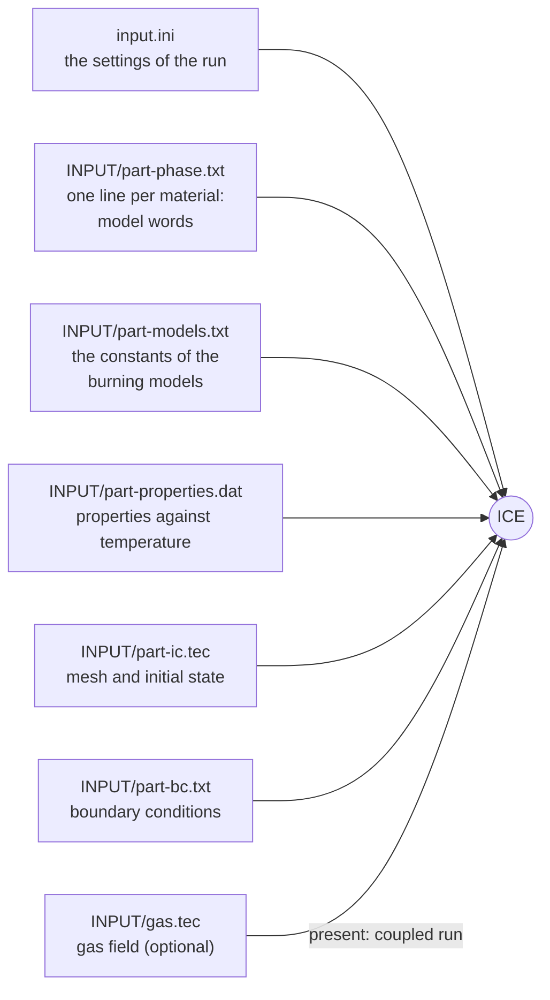

# Input Files

A case gives ICE one settings file, `input.ini`, and a few data files in `INPUT/`. This page says what each holds and
where to switch on every mode and model. The other User Guide pages explain each topic in turn.



ATLAS writes every file of `INPUT/` except the gas field, which comes from the gas solver. `input.ini` is written by
hand (or by ATLAS's GUI). The folder layout is in [Using ICE](using.md#the-case-folder).

---

## Where to switch things on

| To get | Set | In | Page |
|---|---|---|---|
| **A coupled run** (the drops feel the gas) | the gas field `INPUT/gas.tec` | the case folder | [Run Settings](general.md#standalone-or-coupled) |
| **A steady run** (only the converged field matters) | `time-accurate = false` | `[ICE-Numerics]` | [Numerics](numerics.md#time-accurate-or-steady) |
| **A family of drops** and its closure (MK, IG, AG) | `closure = ...` | `[ICE-FamilyN]` | [Families & Closures](families.md) |
| **Several materials** | one line per material | `part-phase.txt` | [Materials & Models](models.md#the-phase-file) |
| **Drag**, **convective heat** | `drag`, `heat-transfer` | `[ICE-Physics]` | [Materials & Models](models.md#drag-and-heat-transfer) |
| **Radiation** | `emissivity` > 0 | `[ICE-Physics]`, or the table | [Materials & Models](models.md#radiation) |
| **Evaporation** | `evaporation = <model>` | `[ICE-Physics]`, or the material line | [Materials & Models](models.md#evaporation) |
| **Conduction inside the drop**, **boiling** | `liquid-conduction`, `boiling` | `[ICE-Physics]`, or the material line | [Materials & Models](models.md#conduction-and-boiling) |
| **Solidification** | `solidification=on` | the material line | [Materials & Models](models.md#solidification) |
| **Combustion** | `combustion = direct` or `Beckstead`, and a row | `[ICE-Physics]` or the line; `part-models.txt` | [Materials & Models](models.md#combustion) |
| **Properties against temperature** | a zone per material | `part-properties.dat` | [Material Properties](properties.md#the-property-table) |
| **Second order in space** | `space-reconstruction = MUSCL`, a `flux-limiter` | `[ICE-Numerics]` | [Numerics](numerics.md#reconstruction) |
| **Grid sequencing** | `levels = 2` (or more) | `[ICE-Multigrid]` | [Numerics](numerics.md#grid-levels) |
| **Residual smoothing** (steady runs) | `irs = true` | `[ICE-Numerics]` | [Numerics](numerics.md#residual-smoothing) |
| **A restart** | `newrun = false` | `[ICE-Parameters]` | [Using ICE](using.md#restarting) |
| **Probes** | `probe1 = <name>` and a `[<name>]` section | `[ICE-Probes]` | [Using ICE](using.md#probes) |
| **Settings read again during the run** | `ini-diter` | `[ICE-IO]` | [Run Settings](general.md#reading-again-during-the-run) |

---

## `input.ini`

An INI file: sections in square brackets, with `key = value` lines inside them.

- A comment line starts with `;`, `#` or `!`. A `;` also ends a value early, so the rest of the line is a comment.
- An unknown key in a section of ICE stops the run and is named: a misspelt key would otherwise be ignored without a
  word. Sections that are not ICE's are left alone, so the file can also hold the settings of other tools.
- The section names and most keys are the same as [MOSE](https://github.com/open-hydra/MOSE)'s.

| Section | Contents | Page |
|---|---|---|
| `[ICE-Parameters]` | Restart, when to stop, the names of the phase files | [Run Settings](general.md) |
| `[ICE-IO]` | File formats, output frequencies, the folder of the gas field | [Run Settings](general.md#outputs) |
| `[ICE-Numerics]` | Time scheme, CFL number, reconstruction, limiter, Riemann solver, smoothing | [Numerics](numerics.md) |
| `[ICE-Multigrid]` | Grid levels and the iterations on each | [Numerics](numerics.md#grid-levels) |
| `[ICE-Physics]` | The exchange models, and the properties of the materials and their vapour | [Materials & Models](models.md) |
| `[ICE-FamilyN]` | One per family of drops: its closure | [Families & Closures](families.md) |
| `[ICE-Probes]`, `[<probe name>]` | The probes: where, what, how often | [Using ICE](using.md#probes) |

Every key, with its default and allowed values, is in the [Parameter Registry](registry.md).

### A minimal file

```ini
[ICE-Parameters]
time-threshold = 0.125

[ICE-Numerics]
time-scheme          = RK2
cfl                  = 0.5
time-accurate        = true
space-reconstruction = MUSCL
flux-limiter         = vanleer

[ICE-Physics]
drag          = Stokes
heat-transfer = Ranz-Marshall

[ICE-IO]
ic-format   = tecplot ascii
sol-format  = tecplot ascii
shell-diter = 100

[ICE-Family1]
closure = AG
```

Five keys are required: `time-scheme`, `cfl`, `time-accurate`, `space-reconstruction` and `closure`. Everything else
has a default.

---

## The files of `INPUT/`

| File | Holds | Needed | Page |
|---|---|---|---|
| `part-ic.tec` | the mesh and the initial state of every family | always | [Initial Conditions](initial-conditions.md) |
| `part-bc.txt` | the boundary conditions (`part-bc<n>.txt` for grid level *n*) | always | [Boundary Conditions](boundary-conditions.md) |
| `part-phase.txt` | the materials and their model words | with several materials, or a model chosen per material | [Materials & Models](models.md#the-phase-file) |
| `part-models.txt` | the constants of the burning models | with combustion | [Materials & Models](models.md#the-models-file) |
| `part-properties.dat` | the properties of each material against temperature | with several materials | [Material Properties](properties.md#the-property-table) |
| `gas.tec` | the gas field | for a coupled run | [Run Settings](general.md#standalone-or-coupled) |
| `phase.txt` | the gas phase: its species | with combustion, ICE running alone | [Materials & Models](models.md#the-gas-the-burnt-mass-becomes) |

The prefix `part-` is the standalone default. `phase = <name>` in `[ICE-Parameters]` reads `INPUT/<name>-...` instead,
as ATLAS names the files of a phase called `<name>`.
