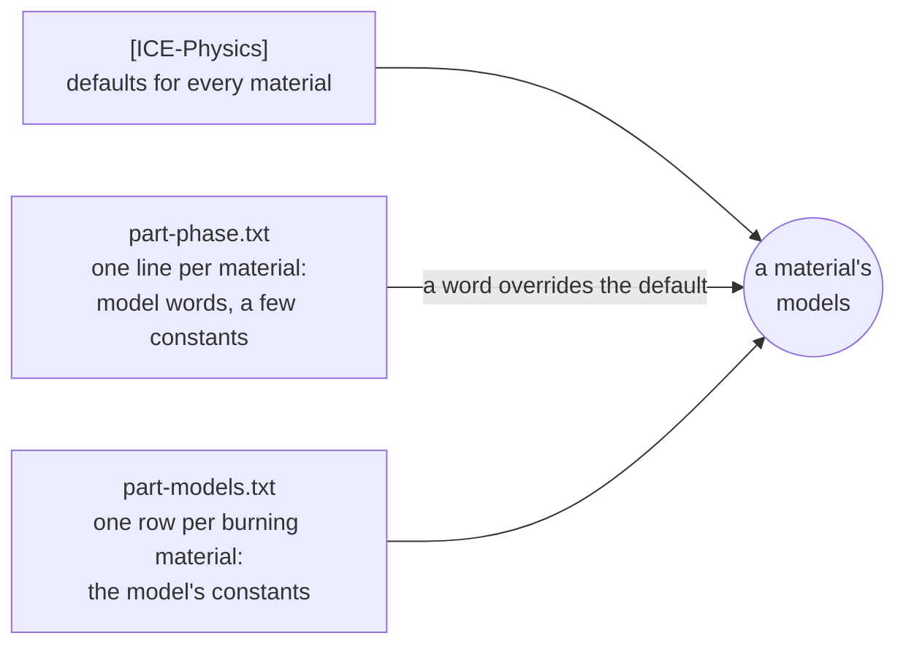
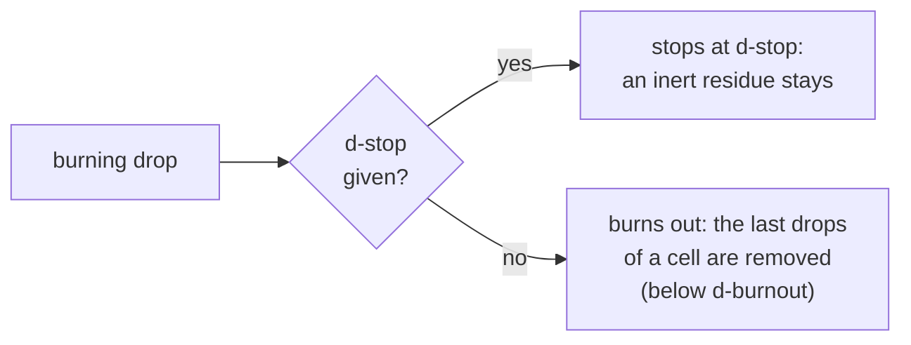

# Materials & Models

Each material picks its physics in three places:



- **`[ICE-Physics]`** in `input.ini` sets drag and heat transfer for every material, and the default evaporation,
  conduction, boiling and combustion models.
- **The phase file** has one line per material. A word on the line overrides the default for that material.
- **The models file** holds the constants of the burning models.

ATLAS writes both files from `[GPB-Phase*]`. At set-up ICE prints the models of each material. The models act in a
coupled run only ([Standalone or coupled](general.md#standalone-or-coupled)).

| Model | Switch it on | Where | Theory |
|---|---|---|---|
| Drag | `drag = <name>` | `[ICE-Physics]` | [Drag](../theory/drag-heat.md#drag) |
| Convective heat | `heat-transfer = <name>` | `[ICE-Physics]` | [Convective heat](../theory/drag-heat.md#convective-heat-transfer) |
| Radiation | `emissivity` > 0 | `[ICE-Physics]`, or the property table | [Radiation](../theory/drag-heat.md#radiation) |
| Evaporation | `evaporation = <model>` | `[ICE-Physics]` or the line | [Evaporation](../theory/evaporation.md) |
| Conduction inside the drop | `liquid-conduction = P2T` | `[ICE-Physics]` or the line | [Conduction](../theory/evaporation.md#conduction-inside-the-drop) |
| Boiling | `boiling = ZGR` | `[ICE-Physics]` or the line | [Boiling](../theory/evaporation.md#boiling) |
| Solidification | `solidification=on` | the line | [Solidification](../theory/solidification.md) |
| Combustion | `combustion = direct` or `Beckstead`, and a row | `[ICE-Physics]` or the line; the models file | [Combustion](../theory/combustion.md) |

---

## The phase file

`INPUT/part-phase.txt`, written by ATLAS:

```text
condensed-dispersed phase
A 1 evaporation=CEM
B 2 combustion=direct
```

The first line names the phase type. Each further line is a material: its **name**, its number of **groups** (the
families it makes, [Families & Closures](families.md#families-and-materials)), and any number of `key=value` words.
A material of 0 groups stops the run: it is a material another drop carries, which ICE does not model (IGLOO does).

| Word | Values | Section below |
|---|---|---|
| `evaporation` | `d2-law`, `CEM`, `CEM-B`, `ASM`, `TC`, `none` | [Evaporation](#evaporation) |
| `interface`, `alpha-e` | `VLE`, `LK`; a number | [Evaporation](#evaporation) |
| `liquid-conduction`, `k-liq`, `mu-liq` | `ITC`, `P2T`; numbers | [Conduction and boiling](#conduction-and-boiling) |
| `boiling` | `clamp`, `ZGR` | [Conduction and boiling](#conduction-and-boiling) |
| `solidification`, `T-melt`, `h-fus`, `T-nuc`, `cp-solid` | `on`, `off`; numbers | [Solidification](#solidification) |
| `combustion` | `none`, `direct`, `Beckstead` | [Combustion](#combustion) |
| `carry` | refused: a carried material is IGLOO's model, not ICE's | |
| `breakup` | ignored with a warning: ICE has no breakup model | |

The words are the same as [IGLOO](https://github.com/open-hydra/IGLOO)'s. An unknown word, or a value that is not a
number where one is expected, stops the run. The constants of the burning models never go on the line: they belong to
the models file. The properties given per material (density, latent heat, ...) are in
[Material Properties](properties.md).

---

## The models file

`INPUT/part-models.txt`, beside the phase file: one row per burning material.

```text
<material> combustion <model> key=value key=value ...
```

`<model>` repeats the word of the material line, or is `-` for the model the line or `[ICE-Physics]` names. Keys come
in any order, and a line starting with `#` is a comment.

```text
A combustion direct q-comb=9.53e6 d-stop=6e-5 T-burn=2791
```

The constants each model reads are under [Combustion](#combustion). A row of the kind `breakup` is ignored with a
warning; a row of the kind `carry` stops the run.

---

## Drag and heat transfer

!!! example "Switch it on"
    ```ini
    [ICE-Physics]
    drag          = Schiller-Naumann
    heat-transfer = Ranz-Marshall
    ```

Both apply to every family, and **a coupled run needs both**: if either is left at `none`, the run stops and lists the
valid names.

| Key | Values | Off |
|---|---|---|
| `drag` | `Newton`, `Stokes`, `Schlichting`, `Schiller-Naumann`, `Wen-Yu`, `Putnam`, `Clift-Gauvin`, `Morsi-Alexander`, `Carlson-Hoglund`, `Henderson`, `Crowe`, `Hermsen` | `NoDrag` |
| `heat-transfer` | `Stokes`, `JAXA1`, `JAXA2`, `JAXA3`, `JAXA4`, `Ranz-Marshall`, `Kavanau-Drake` | `NoHeat` |

`NoDrag` and `NoHeat` switch the exchange off on purpose. The word `Chang` is refused with a pointer to `JAXA3`, which
is its formula. The correlations are in [Drag & Heat Transfer](../theory/drag-heat.md).

---

## Radiation

!!! example "Switch it on"
    ```ini
    [ICE-Physics]
    emissivity = 0.3          ; one value per material
    ```

There is no model key: the emissivity of each material decides.

| Value | Effect |
|---|---|
| 0 (default) | no radiation |
| between 0 and 1 | a grey body of that emissivity, against the local gas temperature |
| above 1 | cut to 1, with a warning |
| negative | the run stops |

An `Emissivity` column in the property table replaces the key for that material; give the key 0 for it.

---

## Evaporation

!!! example "Switch it on"
    For every material, in `input.ini`:
    ```ini
    [ICE-Physics]
    evaporation           = CEM
    latent-heat           = 2.26e6
    vapour-molar-mass     = 18.015
    vapour-specific-heat  = 0
    boiling-temperature   = 373.15
    lewis-number          = 1
    vapour-mass-fraction  = 0
    ```
    or for one material, on its line: `A 1 evaporation=CEM`.

`evaporation` is `none` by default; while it is, the vapour keys are not read.

| Model | What it is |
|---|---|
| `d2-law` | the classical stagnant-film rate, driven by the thermal Spalding number |
| `CEM` | the mass Spalding number with the Ranz-Marshall convective correction |
| `CEM-B` | `CEM` with the gas properties at the 1/3-rule film temperature |
| `ASM` | Abramzon-Sirignano: the film model, with its own gas-side heat |
| `TC` | Tonini-Cossali: its own gas-side heat, Stefan flow included |

An evaporating material needs six quantities, and the run stops naming the one missing:

| Key of `[ICE-Physics]` | Or the table column |
|---|---|
| `latent-heat` | `Lv`, a function of temperature |
| `vapour-molar-mass` | `Mv` |
| `vapour-specific-heat` (0: the gas cp) | `Cpv`, a function of temperature |
| `boiling-temperature` (or `Tboil`, not both) | |
| `lewis-number` | |
| `vapour-mass-fraction` | |

The saturation pressure follows the Clausius-Clapeyron curve through `boiling-temperature` at `boiling-pressure` (one
atmosphere unless given), or the `Psat` column of the property table when it has one
([Material Properties](properties.md)).

Two refinements:

| Key | Where | Values (default) | Meaning |
|---|---|---|---|
| `evaporation-interface` | `[ICE-Physics]`; `interface` on the line | `VLE`, `LK` (`VLE`) | equilibrium at the surface, or Langmuir-Knudsen non-equilibrium |
| `evaporation-coefficient` | `[ICE-Physics]`; `alpha-e` on the line | number (1) | the accommodation coefficient of `LK` |
| `evaporation-blowing` | `[ICE-Physics]` only, every material | `none`, `LK` (`none`) | the Stefan-blowing reduction of the convective heat; ignored under `ASM` and `TC` |

The run stops on `interface = LK` with the `d2-law`. Theory: [Evaporation](../theory/evaporation.md).

---

## Conduction and boiling

!!! example "Switch it on"
    On an evaporating material's line: `A 1 evaporation=CEM liquid-conduction=P2T k-liq=0.6 mu-liq=1e-3 boiling=ZGR`

Both apply to an evaporating material only: the run stops on `P2T` or `ZGR` for a material that does not evaporate.

| Key (`[ICE-Physics]` or the line) | Values (default) | Needs |
|---|---|---|
| `liquid-conduction` | `ITC` (uniform drop temperature), `P2T` (parabolic profile) | `P2T`: `k-liq` [W/(m K)] and `mu-liq` [Pa s] above 0 on the line, or the `Conductivity` and `Viscosity` columns |
| `boiling` | `clamp` (hold the vapour fraction below 1), `ZGR` (Zuo-Gomes-Rutland boiling branch) | |

Theory: [Conduction inside the drop](../theory/evaporation.md#conduction-inside-the-drop),
[Boiling](../theory/evaporation.md#boiling).

---

## Solidification

!!! example "Switch it on"
    On the material's line: `A 1 solidification=on T-melt=2327 h-fus=1.07e6 cp-solid=1360`

All its keys are words of the material line:

| Word | Meaning | Default |
|---|---|---|
| `solidification` | `on` or `off` | `off` |
| `T-melt` | melting temperature [K] | 2327 |
| `h-fus` | heat of fusion [J/kg] | required, > 0 |
| `T-nuc` | nucleation temperature [K], below `T-melt` | 0.8 `T-melt` |
| `cp-solid` | specific heat of the solid [J/(kg K)] | required, > 0 |

- The liquid's specific heat and the density are the material's. The specific heat may vary with temperature (a `Cp`
  column); the density must be constant.
- The run stops on a `Density` column that varies, and on a material that also evaporates.
- Each family of the material carries two more variables, the frozen and the nucleated fractions, in its initial state
  ([Initial Conditions](initial-conditions.md#variable-order)).
- The set-up prints each solidifying material's values.

Theory: [Solidification](../theory/solidification.md).

---

## Combustion

!!! example "Switch it on"
    The model on the material's line (or `combustion = direct` in `[ICE-Physics]` for every material whose line names
    none; the line wins):
    ```text
    A 1 combustion=direct
    ```
    and its constants in the models file:
    ```text
    A combustion direct q-comb=9.53e6 d-stop=6e-5 T-burn=2791
    ```

| | `direct` | `Beckstead` |
|---|---|---|
| Burns from | the burning temperature | the ignition temperature `T-ign` |
| Rate | $d^2$ law, the heat of reaction in the transfer number | $d^n$ law |
| Drop temperature while burning | held at the burning temperature | follows its heat balance |

The constants, all in the models file:

| Key | Meaning | Model | Default |
|---|---|---|---|
| `q-comb` | heat of reaction per unit burnt mass [J/kg] | both | required (0 allowed) |
| `d-stop` | diameter of the inert residue [m] | both | none: the drop burns out |
| `d-burnout` | diameter at which the last drops of a cell are removed [m] | both | a drop mass of 1e-20 kg |
| `d-gen` | diameter of the drops of the generated mass [m], > 0 | both | none; read only when a coupler declares a generated mass |
| `T-burn` | burning temperature [K] | `direct` | `boiling-temperature` |
| `K-burn` | burning coefficient [m$^n$/s] | `Beckstead` | required |
| `n-burn` | exponent of the $d^n$ law, between 0 and 3 | `Beckstead` | 1.8 |
| `X-eff` | oxidiser fraction | `Beckstead` | 1 |
| `T-ign` | ignition temperature [K] | `Beckstead` | 2350 |
| `beta-part` | share of the heat of reaction the drop keeps | `Beckstead` | 0 |

- `direct` also needs the latent heat at the burning temperature: the `Lv` column of the property table, else
  `latent-heat`. With the column, leave `latent-heat` out or give 0 for that material.
- `boiling-temperature` stands for the burning temperature at one atmosphere only: with `boiling-pressure` at another
  value, the row must give `T-burn`.

### Residue or burn-out



A drop that does not burn is never removed. `d-stop` and `d-burnout` exclude each other.
Theory: [Burn-out](../theory/combustion.md#burn-out).

!!! tip "Comparing with IGLOO"
    To compare a material with its IGLOO run, give `d-burnout` in both decks, at about 0.1 of the injected diameter:
    the removal then hands over a thousandth of the drop's mass.

### The generated mass

ICE running alone generates none. Inside hydra, a coupler that knows the reaction declares it, and the oxide of the
burning drops is born in another family, with the diameter `d-gen`
([Generated mass](../theory/combustion.md#generated-mass)).

### The gas the burnt mass becomes

ICE running alone takes the burnt vapour to be the gas itself, so the gas phase file must declare one species:
`INPUT/phase.txt`, or `INPUT/<gas-phase>-phase.txt` with `gas-phase` in `[ICE-Parameters]`. Written by hand:

```text
ideal-gas phase
GAS 30.14
```

Inside hydra the coupler owns the gas, and ICE reads no gas phase file.

### What stops the set-up

- a burning material that also evaporates or solidifies;
- a constant of the models file left on the material line, or given in `[ICE-Physics]` (`q-comb`, `d-stop`,
  `d-burnout`);
- a row without `q-comb`; `d-stop` beside `d-burnout`; the former key `d-res`;
- a row of another kind (`carry`, IGLOO's carried material), of another model than the material's, with a key its
  model does not read, a second row for one material, or a row for no material of the phase file;
- `direct` without its latent heat or its burning temperature;
- `Beckstead` without `K-burn`;
- with ICE running alone, a gas phase file that does not declare one species.

Theory: [Combustion](../theory/combustion.md).
