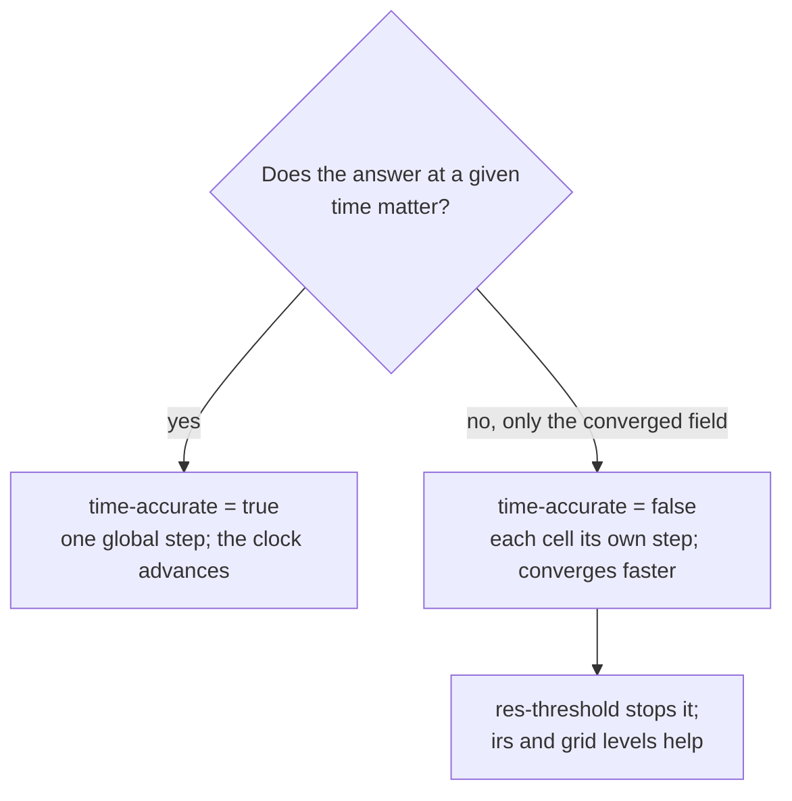

# Numerics

The scheme ICE advances the families with: time integration, step size, reconstruction, Riemann solver, residual
smoothing and grid levels. The keys are in `[ICE-Numerics]` and `[ICE-Multigrid]`; the methods are in
[Spatial Discretization](../theory/numerics.md) and [Time Integration](../theory/time-integration.md).

| To get | Set | Default |
|---|---|---|
| a steady run | `time-accurate = false` | required |
| a higher-order time scheme | `time-scheme = RK2` or `RK3` | required |
| second order in space | `space-reconstruction = MUSCL` and a `flux-limiter` | required; limiter `none` |
| first order at shocks | `shock-detector = Jameson` | `none` |
| another flux | `riemann-solver = Rusanov` or `HLLE` | `Saurel` for MK, `Rusanov` for IG and AG |
| a larger stable CFL (steady) | `irs = true` | `false` |
| a coarse grid to start on | `levels = 2` in `[ICE-Multigrid]` | 1 |

---

## Time-accurate or steady



| | Time-accurate | Steady |
|---|---|---|
| Step | the smallest over every cell, block, family and MPI rank | each cell its own |
| Clock | advances by the step | none |
| Stops on | `iter-threshold`, `time-threshold` | those, and `res-threshold` ([Run Settings](general.md#when-the-run-stops)) |
| Residual smoothing | refused | allowed |

Theory: [Time-accurate or steady](../theory/time-integration.md#time-accurate-or-steady).

---

## The time step

| Key | Default | Meaning |
|---|---|---|
| `time-scheme` | required | `euler`, `RK2`, `RK3` |
| `cfl` | required | the Courant number of the signal speeds **summed over the directions** |
| `dt-max` | 1e-4 | a ceiling on the step [s], after the CFL factor |
| `tau-factor` | 1 | a ceiling as a multiple of the drops' relaxation time, coupled runs only (0: off) |

The largest stable `cfl`:

| `time-scheme` | `cfl` up to |
|---|---|
| `RK2` | 1 |
| `RK3` | 1.17 (1.256 with first-order reconstruction) |
| `euler` | 1 with first-order reconstruction; with `MUSCL`, the limiter's bound (below) |

With `euler` and `MUSCL` the bound is 0.5 for `vanleer`, `mc`, `superbee`, `koren`, `umist` and `ospre`; 0.586 for
`vanalbada`; 0.571 for `sweby` and `osher`; 0.667 for `minmod`. Above it ICE warns. Keep a margin where shocks and
limiters act, for example `cfl = 0.8` with `RK2`.

`tau-factor = 1` keeps the velocity relaxation stable; a coupled IG or AG run with `RK2` wants `tau-factor = 0.5`, as
the dispersion relaxes twice as fast. In a time-accurate run the step follows the smallest relaxation time in the
domain, so a family of small or burning drops slows the whole run.
Theory: [The time step](../theory/time-integration.md#the-time-step).

---

## Reconstruction

| Key | Values (default) | Meaning |
|---|---|---|
| `space-reconstruction` | `first-order`, `MUSCL` (required) | the face states: the cell values, or limited linear slopes |
| `flux-limiter` | `minmod`, `vanalbada`, `vanleer`, `ospre`, `umist`, `osher`, `sweby`, `mc`, `koren`, `superbee`, `none` (`none`) | the slope limiter of `MUSCL` |
| `shock-detector` | `Jameson`, `none` (`none`) | back to first order where the density has a shock |

Theory: [Reconstruction](../theory/numerics.md#reconstruction).

---

## Riemann solver

| `riemann-solver` | Applies to | Notes |
|---|---|---|
| `Saurel` | MK only (refused for IG and AG) | the default of MK |
| `Rusanov` | any closure | the default of IG and AG |
| `HLLE` | any closure with a signal speed | less dissipative on a contact, a Roe average per face |

Left empty, each family takes its closure's default. Theory: [Riemann solvers](../theory/numerics.md#riemann-solvers).

---

## Residual smoothing

!!! example "Switch it on (steady runs)"
    ```ini
    [ICE-Numerics]
    time-accurate = false
    irs           = true
    irs-beta      = 0.5
    ```

Implicit residual smoothing widens the stability region, so a larger `cfl` becomes usable. It changes the transient,
so it belongs to steady runs: a time-accurate run with `irs = true` stops at set-up.
Theory: [Residual smoothing](../theory/time-integration.md#residual-smoothing).

---

## Grid levels

!!! example "Switch it on"
    ```ini
    [ICE-Multigrid]
    levels      = 2
    level1-iter = 5000
    level2-iter = 500
    ```

`levels = 2` adds a coarse grid with half the cells in every direction, so every block dimension must be divisible by
$2^{levels-1}$. The run starts on the coarsest level and goes to the next after its `level<n>-iter` iterations.
Theory: [Grid sequencing](../theory/time-integration.md#grid-sequencing).

Each level needs **its own boundary file**, because the records are per boundary cell:

| Level | File |
|---|---|
| 1 (the fine grid) | `INPUT/part-bc.txt` |
| 2 | `INPUT/part-bc2.txt` |
| *n* | `INPUT/part-bc<n>.txt` |

ATLAS BCB writes them all when `MG-levels` is set in its `[ATLAS-Parameters]`, so the two settings must agree. ICE
checks the number of records of each file against its level and stops if they differ.
