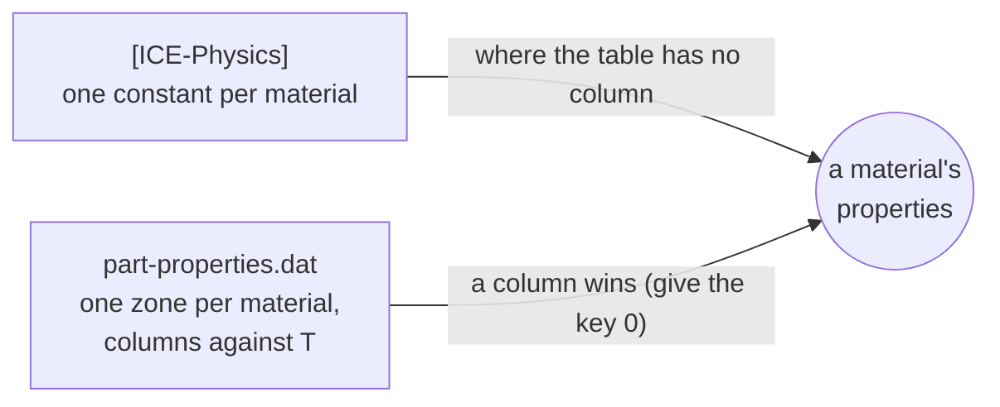

# Material Properties

A material's density, specific heat and vapour properties come from two places: constants of `[ICE-Physics]`, one
value per material, or the columns of the property table, against temperature.



| Material | Property table |
|---|---|
| one | optional: without it, the constants of `[ICE-Physics]` |
| several | required, one zone per material |

---

## Properties given per material

These keys of `[ICE-Physics]` take one value per material, in the order of the
[phase file](models.md#the-phase-file) (`emissivity = 0 0` for two materials); another count stops the run.

| Key | Unit | Default | Used by | Or the column |
|---|---|---|---|---|
| `density` | kg/m³ | 2700 | every material | `Density` |
| `specific-heat` | J/(kg K) | 1598 | every material | `Cp` |
| `emissivity` | – | 0 | [radiation](models.md#radiation) | `Emissivity` |
| `latent-heat` | J/kg | 1.08e7 | [evaporation](models.md#evaporation), `combustion = direct` | `Lv` |
| `vapour-molar-mass` | kg/kmol | 26.98 | evaporation | `Mv` |
| `vapour-specific-heat` | J/(kg K) | 0: the gas cp | evaporation | `Cpv` |
| `boiling-temperature` (or `Tboil`) | K | 2792 | evaporation, `combustion = direct` | |
| `boiling-pressure` | Pa | 101325 | evaporation | |
| `lewis-number` | – | 1 | evaporation | |
| `vapour-mass-fraction` | – | 0 | evaporation | |
| `evaporation-coefficient` | – | 1 | `interface = LK` | |

When the property table has a column for a quantity (`Lv`, `Mv`, `Cpv` or `Emissivity`), give the key 0 for that
material: the table sets it. The liquid conductivity and viscosity of `liquid-conduction = P2T` are words of the
material line, `k-liq` and `mu-liq` ([Conduction and boiling](models.md#conduction-and-boiling)).

---

## The property table

`INPUT/part-properties.dat` gives the properties of the materials as functions of
temperature. It is optional with one material, and required with several. ATLAS writes
it; this is its layout:

```
TITLE = "Mass Thermodynamic Properties"
VARIABLES = "Temperature", "Cp", "Density", "Enthalpy"
ZONE T="A"
I=5000, F=POINT
   1.0   900.0  2700.0    900.0
   2.0   900.0  2700.0   1800.0
   ...
```

- **One zone per material**, in the order of the [phase file](models.md#the-phase-file),
  all on the same temperatures.
- **The rows sit on consecutive integer kelvins**, at least two of them, from any
  first temperature. Between the rows the values are linear in $T$; outside the table
  they keep the end values.
- **Packing:** `F=POINT` (one row per line, as above) or `BLOCK` (one column after
  the other). A zone that gives neither is `BLOCK`, as Tecplot reads it.

### Columns

`Temperature` comes first; the others may be in any order.

| Column | Unit | Required | Used for |
|---|---|---|---|
| `Temperature` | K | yes | the rows |
| `Cp` | J/(kg K) | yes | the specific heat of the material |
| `Density` | kg/m³ | yes | the density of the material |
| `Enthalpy` or `Enthalpy_abs` | J/kg | one of the two | the energy of the particles (below) |
| `Psat` | Pa | no | the saturation pressure, in place of the Clausius-Clapeyron curve |
| `Lv` | J/kg | no | the latent heat, against temperature |
| `Mv` | kg/kmol | no | the vapour molar mass, the same on every row |
| `Cpv` | J/(kg K) | no | the vapour specific heat, against temperature |
| `Emissivity` | – | no | the emissivity, against temperature |
| `Conductivity`, `Viscosity` | W/(m K), Pa s | no | the liquid conductivity and viscosity of a `P2T` material |
| `Sigma` | N/m | no | recognised and not used |

Other columns are ignored. `Enthalpy` is relative ($c_p T$ for a constant $c_p$);
`Enthalpy_abs` is absolute, and its offset is kept as the material's datum. When $c_p$
varies, the particle energy is the enthalpy column itself, so its datum does not matter
([Energy and temperature](../theory/governing-equations.md#energy-and-temperature)).

The optional columns are read only where they apply: `Psat`, `Lv`, `Mv` and `Cpv` for
a material that evaporates, `Conductivity` and `Viscosity` for one that runs
`liquid-conduction = P2T`, `Emissivity` for every material. A column of zeros counts
as absent. Emissivities above 1 are cut to 1, with a warning.

### Columns and INI keys together

- **`density` and `specific-heat`** may be left out with a table. If given, a value
  must equal the material's constant column; against a column that varies it stops the
  run. Without a table, the one material takes these two constants. ICE prints which
  of the two it uses.
- **`latent-heat`, `vapour-molar-mass`, `vapour-specific-heat` and `emissivity`** must
  be 0 for a material whose table has the same quantity as a column, even if the two
  agree. With two materials, `latent-heat = 0 2.26e6` lets the table set A's and gives
  B, which has no column, its value.
- **`k-liq` and `mu-liq`** on the material line must be absent (or 0) when the table
  has the `Conductivity` and `Viscosity` columns.

At setup ICE prints the tabulated vapour values of each evaporating material: $L_v$ at
298.15 K, which becomes its scalar latent heat, and $L_v$, $M_v$ and $c_{p,v}$ at the
boiling temperature.

### What ICE checks in the table

ICE refuses the table, with the reason, when:

- **ORION cannot read the file**: a row with a number too many or too few, a zone that
  holds another number of rows than it announces, anything after the last row. ORION's
  message says what and where;
- **the columns** are missing one, name one twice, or name both enthalpies;
- **the zones** are not one per material, are not one line of rows (`J=` or `K=` above
  1), or are not on the same temperatures;
- **the rows** go below 0 K or are off the integer kelvins (by more than $10^{-6}$ K);
- **the values** are not physical: a density or $c_p$ that is not positive, an
  enthalpy that does not increase with $T$, or disagrees with $c_p$ (with a constant
  $c_p$, $h = c_p T + h_{off}$ on every row; with a varying one, the trapezoidal
  integral of $c_p$ within 0.1 % per step), or a relative `Enthalpy` with an offset;
- **`Psat`**, for an evaporating material, is not finite, is negative, constant or
  decreasing, or does not give `boiling-pressure` within a factor 2 at
  `boiling-temperature` (which must lie inside the table);
- **`Lv`, `Mv`, `Cpv`** are not finite, negative, zero on some rows only, given without
  `Psat`, an `Mv` that varies, or an `Lv` whose Clausius-Clapeyron slope at the boiling
  temperature is not within a factor 2 of the `Psat` column's. An `Lv` column without
  `Mv` needs `vapour-molar-mass`, which the slope uses;
- **`Emissivity`, `Conductivity`, `Viscosity`** are zero on some rows only, or not
  positive.
